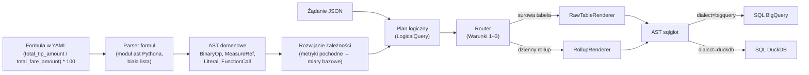

# Faza 1 – Decyzje projektowe i materiał do pracy magisterskiej

## 0. Jak korzystać z tego dokumentu

Dokument jest materiałem źródłowym dla konsultanta (Gemini Notebook) wspierającego pisanie pracy magisterskiej **„Projekt i implementacja hybrydowego routera zapytań analitycznych z semantyczną warstwą abstrakcji”**. Opisuje decyzje projektowe podjęte przed implementacją fazy 1 (rdzeń kompilatora i lokalny cache), ich uzasadnienie, rozważone alternatywy oraz podstawy teoretyczne.

Zasady dla konsultanta:
- Opieraj się na treści tego dokumentu, dokumentów specyfikacji (01–04) i notatek implementacyjnych (`A1…A5`). Jeśli czegoś w nich nie ma – powiedz to wprost, zamiast uzupełniać domysłem.
- Pozycje w sekcji „Literatura” są **kandydatami do weryfikacji**. Nie podawaj numerów stron, cytatów ani szczegółów bibliograficznych, których tu nie ma.
- Wyniki liczbowe implementacji (czasy, liczby testów, rozmiary) pochodzą wyłącznie z notatek implementacyjnych. Ten dokument opisuje stan **przed** implementacją.

Status: decyzje zatwierdzone przez autora (sesja projektowa, 1 listopada 2026). Implementacja fazy 1: w toku.

---

## 1. Kontekst: system i miejsce fazy 1

System jest bezstanowym serwisem HTTP (FastAPI), który przyjmuje deklaratywne zapytania analityczne w JSON (wymiary, metryki, filtry), kompiluje je do SQL i wykonuje na jednym z dwóch silników:
- **Google BigQuery** – chmurowa hurtownia danych z pełnymi, surowymi danymi; wysoki koszt (model on-demand, 6,25 USD za 1 TB) i opóźnienie rzędu sekund,
- **DuckDB** – wbudowany (in-process) silnik OLAP operujący na lokalnych, dziennych agregatach (rollupach) zapisanych w plikach Apache Parquet; opóźnienie rzędu milisekund, brak kosztu za zapytanie.

Router wybiera silnik automatycznie. Wiedza o danych (wymiary, miary, wzory wskaźników) jest zapisana w konfiguracji YAML – **warstwie semantycznej** – dzięki czemu system jest niezależny od konkretnego zbioru danych. Zbiorem badawczym jest publiczny zbiór NYC Yellow Taxi Trips (BigQuery Public Datasets).

**Faza 1** (tygodnie 1–3 harmonogramu) buduje rdzeń bez dostępu do chmury: konfigurację, kompilator zapytań, lokalny cache DuckDB, weryfikację poprawności i minimalne API. BigQuery, strażnik kosztów, pełny router i synchronizacja z chmurą to fazy 2–3.

---

## 2. Potok kompilacji zapytania

Etapy:
1. **Parsowanie formuł** metryk pochodnych do własnego drzewa składniowego (AST domenowego).
2. **Rozwijanie zależności** – metryka odwołująca się do innej metryki jest rekurencyjnie rozwijana, aż liśćmi drzewa są wyłącznie miary bazowe; cykle są wykrywane.
3. **Plan logiczny** – niezależny od silnika opis zapytania: wymiary, rozwinięte metryki, filtry, sortowanie, zakres dat, zbiór użytych miar.
4. **Routing** – decyzja podejmowana na planie logicznym (semantyce zapytania), nie na tekście SQL.
5. **Renderowanie** – plan jest zamieniany na drzewo SQL biblioteki `sqlglot`; sposób zamiany liści zależy od **typu źródła danych** (surowa tabela vs rollup), a dialekt SQL jest osobnym parametrem.

Przykład dla metryki `tip_to_fare_ratio_pct`:

| Źródło | Wynik renderowania |
|---|---|
| Surowa tabela (BigQuery) | `(SUM(tip_amount) / NULLIF(SUM(fare_amount), 0)) * 100` |
| Dzienny rollup (DuckDB) | `(SUM(total_tip_amount) / NULLIF(SUM(total_fare_amount), 0)) * 100` |

W rollupie kolumna `total_tip_amount` zawiera już sumę dzienną, więc zapytanie sumuje sumy dzienne, a dzielenie wykonuje na końcu.

---

## 3. Decyzje projektowe fazy 1

Każda decyzja zawiera alternatywy i powód ich odrzucenia – przydatne przy pytaniach „dlaczego nie X?” podczas obrony.

### ADR-008: Plan logiczny i renderery zamiast transpilacji tekstu SQL
- **Decyzja:** zapytanie jest kompilowane do planu logicznego, a z niego – przez renderer właściwy dla typu źródła – do drzewa `sqlglot`, z którego generowany jest SQL w dialekcie docelowym. Pełny tekst SQL nigdy nie jest ponownie parsowany.
- **Jedyny wyjątek:** fragmenty SQL zapisane w YAML (np. `TIMESTAMP_DIFF(...)`) są w dialekcie BigQuery i parsowane jako takie, aby mogły zostać wyrenderowane także dla DuckDB.
- **Alternatywy odrzucone:** (1) generowanie SQL dla BigQuery i transpilacja do DuckDB – decyzja routera oparta na tekście SQL, „łatanie” drzewa po fakcie; (2) szablony tekstowe (np. Jinja) – brak drzewa składniowego, brak gwarancji poprawności, ryzyko SQL injection.
- **Konsekwencja:** rozdzielenie „typu źródła” od „dialektu” umożliwia testy różnicowe (ADR-012) – tę samą semantykę można policzyć dwiema niezależnymi ścieżkami w jednym silniku.

### ADR-009: Własne AST domenowe i bezpieczny parser formuł
- **Decyzja:** formuły są parsowane modułem `ast` Pythona i konwertowane do małego, własnego AST (`MeasureRef`, `Literal`, `BinaryOp`, `UnaryOp`, `FunctionCall`). Dozwolone są wyłącznie: operatory `+ - * /`, minus jednoargumentowy, literały liczbowe, nazwy miar i wywołania zarejestrowanych funkcji skalarnych. Każda inna konstrukcja jest odrzucana przy walidacji konfiguracji.
- **Uzasadnienie:** oddzielenie warstwy semantycznej od fizycznej (AST nie zależy od biblioteki SQL); formalnie ograniczona gramatyka – formuła nie może wykonać kodu ani wstrzyknąć SQL; łatwa walidacja i czytelne komunikaty błędów.
- **Rozszerzalność:** węzły przetwarzane są wzorcem *Visitor* – nowa konstrukcja (np. `CASE`) to nowa klasa węzła i obsługa w visitorach; nowa funkcja to wpis w rejestrze, bez zmian w parserze.
- **Alternatywy odrzucone:** węzły `sqlglot` bezpośrednio w planie logicznym (uzależnienie warstwy semantycznej od biblioteki SQL); własna gramatyka w generatorze parserów (dodatkowa zależność bez istotnego zysku).

### ADR-010: Dwupoziomowy model funkcji
- **Decyzja:** funkcje agregujące (`SUM`, `COUNT`, `MIN`, `MAX`, `COUNT_DISTINCT`) występują **wyłącznie** w definicjach miar bazowych i są opisane rejestrem, który dla każdej funkcji określa sposób ponownej agregacji na rollupie (`SUM→SUM`, `COUNT→SUM`, `MIN→MIN`, `MAX→MAX`, `COUNT_DISTINCT→brak`). Formuły metryk pochodnych działają na wartościach już zagregowanych i mogą używać tylko funkcji skalarnych (`ROUND`, `COALESCE`, `ABS`, `GREATEST`, `LEAST`) z drugiego rejestru.
- **Uzasadnienie:** dopuszczenie agregacji wewnątrz formuł przywróciłoby problem „średniej ze średnich” i uniemożliwiłoby routerowi rozstrzygnięcie, czy lokalny rollup może obsłużyć zapytanie. `AVG` jest zabronione jako miara bazowa – zawsze da się je poprawnie wyrazić jako metrykę pochodną `SUM/COUNT`.

### ADR-011: Klasyfikacja funkcji agregujących i miary holistyczne
- **Decyzja:** system w pełni obsługuje miary rozdzielne i algebraiczne (sekcja 4) na obu silnikach. Miary holistyczne nie są materializowane w rollupie; zapytanie, które ich używa (bezpośrednio lub przez metrykę pochodną), jest w całości kierowane do BigQuery (**Warunek 3** routera).
- **Przypadek badawczy:** konfiguracja zawiera miarę `unique_pickup_zones` (liczba unikalnych stref odbioru, `COUNT_DISTINCT`), by benchmark obejmował scenariusz, w którym cache nie może pomóc **z przyczyn matematycznych**, a nie z braku danych.
- Strategie alternatywne – sekcja 4.3.

### ADR-012: Testy różnicowe na danych syntetycznych
- **Decyzja:** poprawność kompilatora i strategii rollupów jest weryfikowana bez dostępu do chmury, przez porównanie wyników dwóch niezależnych ścieżek obliczeń na tych samych danych syntetycznych (sekcja 6).

### ADR-013: Narzędzia projektowe
- Poetry, Python ≥ 3.11, `ruff`, `mypy` (tryb ścisły w rdzeniu kompilatora), `pytest`, git. Implementacja realizowana etapami (A1–A5) przez agentów AI z przeglądem autora po każdym etapie.

---

## 4. Podstawy teoretyczne: addytywność miar

### 4.1. Klasyfikacja funkcji agregujących (Gray i in., 1997)

| Klasa | Definicja | Przykłady | Obliczalna z dziennego rollupu? |
|---|---|---|---|
| **Rozdzielne** (*distributive*) | Wynik dla całego zbioru można obliczyć z wyników dla jego rozłącznych części (tą samą lub inną prostą funkcją) | SUM, COUNT, MIN, MAX | Tak, dokładnie |
| **Algebraiczne** (*algebraic*) | Wynik jest funkcją **ustalonej liczby** wartości rozdzielnych | AVG = SUM/COUNT, średnie ważone, wskaźniki procentowe, ROI, wariancja = SUM(x²)/N − (SUM(x)/N)² | Tak, dokładnie – pod warunkiem przechowywania składników, a nie wyniku |
| **Holistyczne** (*holistic*) | Nie istnieje częściowy stan o ograniczonym rozmiarze, z którego da się złożyć wynik | COUNT DISTINCT, mediana, percentyle, dominanta, top-N | Nie |

Odwzorowanie w systemie: **miary bazowe** = funkcje rozdzielne (materializowane w rollupie), **metryki pochodne** = funkcje algebraiczne (wyliczane w locie ze zsumowanych składników), **miary holistyczne** = kierowane do BigQuery.

### 4.2. „Złota zasada” i kontrprzykład średniej ze średnich

Rollup nigdy nie przechowuje wyników metryk pochodnych, tylko ich składniki (liczniki i mianowniki). Przykład (wartości ilustracyjne):

| Dzień | Napiwki | Opłaty | Wskaźnik dzienny |
|---|---|---|---|
| 1 | 10 | 100 | 10% |
| 2 | 90 | 300 | 30% |
| **Średnia wskaźników dziennych (błędnie)** | | | **20%** |
| **Wskaźnik z sum (poprawnie)** | 100 | 400 | **25%** |

Średnia wskaźników dziennych ignoruje wagę dni (dzień 2 ma trzykrotnie większy wolumen). Poprawny wynik wymaga zsumowania składników z całego okresu i podzielenia na końcu – tak działa generowany SQL. Analogiczny błąd dotyczy średniej prędkości (należy dzielić sumę dystansu przez sumę czasu, a nie uśredniać prędkości).

### 4.3. Problem miar holistycznych – analiza i rozważone strategie

Przykład z praktyki: „liczba unikalnych kupujących danego produktu”. Klient, który kupił produkt w poniedziałek i we wtorek, zostałby policzony dwukrotnie przy sumowaniu dziennych liczników. Rozważone strategie:

1. **Pełne przekierowanie do hurtowni (wybrana).** Wynik dokładny, bez korzyści z cache. Prosta i poprawna; ujawnia granicę stosowalności podejścia opartego na rollupach.
2. **Klucz unikalności jako wymiar rollupu.** Zapisanie np. identyfikatora kupującego w rollupie umożliwia dokładne `COUNT(DISTINCT)` lokalnie, a miary addytywne pozostają poprawne. Koszt: kardynalność rollupu zbliża się do danych surowych. Kompromis rozmiar cache vs pokrycie zapytań, sterowany konfiguracją (`in_rollup`).
3. **Szkice probabilistyczne (*sketches*).** HyperLogLog dla liczności unikalnych, KLL lub t-digest dla kwantyli. Szkic o stałym rozmiarze zapisywany per dzień i łączony przy zapytaniu; błąd rzędu pojedynczych procent. Ograniczenia: wynik przybliżony; DuckDB wymaga rozszerzenia (DataSketches); szkice natywne BigQuery nie są binarnie kompatybilne z DuckDB, więc należałoby je liczyć po stronie synchronizatora.
4. **Dokładny wynik na ziarnie rollupu.** Gdy zapytanie dotyczy pojedynczego dnia i grupuje po wszystkich wymiarach rollupu, wartość dzienna jest dokładna. Przypadek zbyt wąski, by uzasadnić złożoność.

Rejestr agregacji (ADR-010) przewiduje dodanie strategii 2 i 3 bez zmian w architekturze – to naturalny punkt w rozdziale „Możliwości dalszego rozwoju”.

---

## 5. Bezpieczeństwo warstwy semantycznej

- **Formuły:** gramatyka ograniczona białą listą (ADR-009) – konfiguracja nie może wykonać kodu Pythona ani wstrzyknąć dowolnego SQL przez pole `formula`.
- **Wartości filtrów z żądań:** wstawiane do drzewa SQL jako literały (węzły AST), nigdy przez sklejanie tekstu – eliminuje SQL injection od strony klienta API.
- **Dzielenie przez zero:** każde dzielenie przez wyrażenie jest automatycznie zabezpieczane `NULLIF(mianownik, 0)` – wynik `NULL` zamiast błędu wykonania (dzielenie przez stałą niezerową pozostaje bez zmian).
- **Koszt (faza 2):** strażnik kosztów oparty na darmowym `dry_run` BigQuery.

---

## 6. Metodyka weryfikacji poprawności: testy różnicowe

**Idea:** ta sama metryka liczona dwiema niezależnymi ścieżkami musi dać ten sam wynik.

1. Deterministyczny generator (stałe ziarno losowości) tworzy surowe przejazdy o schemacie zgodnym z BigQuery, z przypadkami brzegowymi: zerowe opłaty (test `NULLIF`), wartości `NULL`, przejazdy o zerowym czasie, przejazdy przez północ, dzień bez danych.
2. Z danych surowych budowane są dzienne rollupy Parquet – tym samym generatorem zapytania `GROUP BY`, którego używa synchronizator produkcyjny.
3. Dla macierzy {metryki} × {zestawy wymiarów} × {zakresy dat i filtry} porównywane są:
   - **ścieżka surowa:** renderer surowej tabeli, wykonany w DuckDB na danych surowych (semantyka identyczna z zapytaniem do BigQuery),
   - **ścieżka rollupowa:** renderer rollupu na plikach Parquet.
4. Wyniki muszą być równe z tolerancją numeryczną. Dodatkowy test potwierdza kontrprzykład z sekcji 4.2 na danych syntetycznych.

**Znaczenie dla pracy:** to empiryczny argument, że architektura rozwiązuje problem miar nieaddytywnych – niezależny od wydajności. Testy nie wymagają chmury i są powtarzalne. Ograniczenie: dowodzą zgodności ścieżek na danych syntetycznych, nie poprawności definicji metryk w sensie biznesowym; zgodność z BigQuery na danych rzeczywistych zostanie sprawdzona w fazie 2–3.

---

## 7. Mapowanie na rozdziały pracy

| Rozdział (dok. 04) | Materiał z fazy 1 |
|---|---|
| 1. Wstęp | Problem „średniej ze średnich” jako motywacja (sekcja 4.2) |
| 2. Stan wiedzy | Klasyfikacja Graya (4.1); kompilatory zapytań i AST; szkice probabilistyczne (4.3, krótko); warstwy semantyczne |
| 3. Projekt i architektura | Potok kompilacji (2); ADR-008–ADR-011; **podrozdział „Analiza problemu miar holistycznych”** (4.3) jako dowód świadomej analizy ograniczeń |
| 4. Implementacja | AST domenowe i Visitor; gramatyka formuł i biała lista (5); renderery i NULLIF; rejestry; notatki A1–A5 |
| 5. Eksperymenty | Metodyka testów różnicowych (6) jako weryfikacja poprawności przed pomiarami wydajności; scenariusz `unique_pickup_zones` w benchmarku |
| 6. Podsumowanie | Strategie 2–3 z sekcji 4.3 jako dalszy rozwój; rozszerzalność rejestrów i AST |

---

## 8. Pytania, których można się spodziewać (obrona / recenzja)

- **Dlaczego własne AST, skoro `sqlglot` ma własne drzewo?** – Warstwa semantyczna nie powinna zależeć od biblioteki SQL; własne AST ma formalnie ograniczoną gramatykę (bezpieczeństwo, walidacja), a `sqlglot` jest użyty tam, gdzie jest najmocniejszy – w generowaniu dialektów (ADR-008, ADR-009).
- **Dlaczego nie dzielić zapytania między cache a hurtownię?** – Dominujący koszt czasowy BigQuery to stały narzut startu zapytania, więc podział nie skraca czasu odpowiedzi; łączenie częściowych agregatów z dwóch silników wprowadza ryzyko niespójności typów i precyzji (ADR-004).
- **Co z COUNT DISTINCT?** – Funkcja holistyczna (sekcja 4.1); świadomie kierowana do hurtowni; rozważone strategie i ich koszty w sekcji 4.3.
- **Skąd wiadomo, że wyniki z cache są poprawne?** – Testy różnicowe (sekcja 6).
- **Czy system jest uniwersalny?** – Wiedza o danych jest wyłącznie w YAML; rozszerzalność przez rejestry funkcji i nowe węzły AST. Uniwersalność jest ograniczona świadomie: do miar rozdzielnych i algebraicznych na lokalnym cache.

---

## 9. Literatura – kandydaci (wszystkie pozycje do weryfikacji przez autora)

- J. Gray, S. Chaudhuri, A. Bosworth i in., *Data Cube: A Relational Aggregation Operator Generalizing Group-By, Cross-Tab, and Sub-Totals*, Data Mining and Knowledge Discovery, 1997 – klasyfikacja funkcji agregujących.
- V. Harinarayan, A. Rajaraman, J. D. Ullman, *Implementing Data Cubes Efficiently*, SIGMOD 1996 – materializacja agregatów.
- R. Kimball, M. Ross, *The Data Warehouse Toolkit* (3. wyd.) – miary addytywne, póładdytywne i nieaddytywne w modelowaniu wymiarowym.
- M. Raasveldt, H. Mühleisen, *DuckDB: an Embeddable Analytical Database*, SIGMOD 2019 (demo).
- V. Leis i in., *Morsel-Driven Parallelism*, SIGMOD 2014 – model wykonania w DuckDB.
- S. Melnik i in., *Dremel: Interactive Analysis of Web-Scale Datasets*, VLDB 2010 – podstawa BigQuery.
- P. Flajolet i in., *HyperLogLog: the analysis of a near-optimal cardinality estimation algorithm*, 2007.
- Z. Karnin, K. Lang, E. Liberty, *Optimal Quantile Approximation in Streams* (KLL), 2016.
- T. Dunning, O. Ertl, *Computing Extremely Accurate Quantiles Using t-Digests*, 2019.
- Dokumentacja: Apache Parquet (format, statystyki row group), sqlglot, DuckDB (`read_parquet`, partycjonowanie Hive), BigQuery (`dry_run`, cennik on-demand), Cube i dbt Semantic Layer (warstwy semantyczne).

---

## 10. Słownik pojęć

- **Warstwa semantyczna** – konfiguracja opisująca wymiary, miary i wzory metryk niezależnie od SQL; klient pyta o pojęcia biznesowe, nie o kolumny.
- **Miara bazowa** – agregacja rozdzielna na kolumnie surowej tabeli (np. suma opłat); materializowana w rollupie.
- **Metryka pochodna** – wzór arytmetyczny na miarach (np. stosunek napiwków do opłat); liczona po agregacji.
- **Rollup** – dzienny agregat danych surowych pogrupowany po wybranych wymiarach, zapisany w Parquet.
- **Ziarnistość** – poziom szczegółowości danych; wymiar spoza rollupu (`in_rollup: false`) wymaga danych surowych.
- **Re-agregacja** – ponowna agregacja wartości z rollupu dla dłuższego okresu (np. suma sum dziennych; liczba przejazdów → suma dziennych liczników).
- **Plan logiczny** – niezależny od silnika opis zapytania po rozwinięciu metryk.
- **Renderer** – komponent zamieniający plan logiczny na drzewo SQL dla danego typu źródła.
- **Fallback** – przekierowanie całego zapytania do BigQuery, gdy lokalny cache nie może na nie odpowiedzieć.
- **Testy różnicowe** – porównanie wyników dwóch niezależnych implementacji tej samej semantyki.

---

## 11. Status i wyniki implementacji

*Do uzupełnienia po zakończeniu etapów A1–A5 na podstawie notatek w folderze `notatki-implementacyjne/`.*
