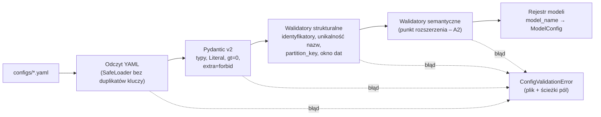

# A1 – Szkielet projektu i warstwa konfiguracji: notatka implementacyjna

## Co zostało zbudowane

- **Środowisko projektu (ADR-013):** `pyproject.toml` w formacie PEP 621 zarządzany przez Poetry 2.x (pakiet `app`, `requires-python >= 3.11`), `poetry.toml` z `virtualenvs.in-project = true`, `poetry.lock`. Wykorzystano istniejący katalog `.venv` utworzony przez PyCharm (CPython 3.13.16 – wersja zgodna z wymaganiami, więc środowiska nie odtwarzano). Konfiguracja `ruff` (lint + formatowanie, długość linii 100) i `mypy` (tryb ścisły dla `app.config`, `app.semantic`, `app.planner`, `app.renderers`, wtyczka `pydantic.mypy`) znajduje się w `pyproject.toml`.
- **Repozytorium:** `.gitignore` (m.in. `.venv/`, `data/`, `.idea/`, katalogi cache narzędzi, `.coverage`, pliki `*.parquet.tmp`); usunięty szablonowy `main.py`.
- **Struktura katalogów** zgodna z dok. 03, sekcja 1: pakiety `app/{config,semantic,planner,renderers,router,executors,sync,api}` z pustymi `__init__.py`. Pliki modułów kolejnych etapów nie zostały utworzone.
- **`configs/nyc_taxi.yaml`** – przepisany 1:1 z dok. 03, sekcja 2 (w tym miara holistyczna `unique_pickup_zones` i metryka `avg_fare_per_trip`).
- **`app/config/schemas.py`** – niemutowalne modele Pydantic v2 (`frozen=True`, `extra="forbid"`): `ModelConfig`, `StorageConfig`, `BigQueryStorageConfig`, `LocalCacheConfig`, `CostGuardConfig`, `DimensionConfig`, `BaseMeasureConfig`, `DerivedMetricConfig`.
- **`app/config/loader.py`** – ładowanie pojedynczego pliku (`load_model_file`), słownika (`load_model_dict`) i katalogu (`load_models_dir` → niemutowalny rejestr `model_name → ModelConfig`), walidacja strukturalna oraz punkt rozszerzenia na walidację semantyczną (`SEMANTIC_VALIDATORS`). Jedyny typ błędu: `ConfigValidationError` (plik + lista `ConfigIssue(path, message)`).
- **`tests/test_config.py`** – 50 przypadków testowych (po parametryzacji).

## Decyzje nieopisane wprost w specyfikacji (decyzja, rozważone alternatywy, uzasadnienie)

1. **Podział walidacji na trzy poziomy.** (a) Pola pojedyncze – modele Pydantic (`Literal`, `gt=0`, niepuste napisy, parsowanie dat); (b) reguły międzypolowe – walidatory strukturalne w loaderze; (c) semantyka – walidatory rejestrowane przez A2. *Alternatywa:* wszystkie reguły jako `model_validator` w Pydantic. *Uzasadnienie:* reguły międzypolowe i semantyczne mają wspólny interfejs `ModelValidator = Callable[[ModelConfig], Iterable[ConfigIssue]]`, dzięki czemu A2 dołącza walidację bez zmiany loadera, a komunikaty mają jednolity format ścieżki pola. Walidatory semantyczne uruchamiane są wyłącznie dla modelu poprawnego strukturalnie (mogą zakładać np. istnienie `partition_key`).
2. **Zbieranie wszystkich problemów zamiast przerywania na pierwszym.** Walidatory strukturalne raportują łącznie wszystkie naruszenia jednego pliku; autor konfiguracji poprawia je w jednym przebiegu.
3. **Duplikaty kluczy w YAML.** PyYAML domyślnie po cichu nadpisuje powtórzony klucz, więc „duplikat nazwy w obrębie sekcji” byłby niewykrywalny na poziomie słownika. Zastosowano podklasę `yaml.SafeLoader` odrzucającą powtórzone klucze z numerem linii. *Alternatywa:* biblioteka `ruamel.yaml` – odrzucona jako dodatkowa zależność.
4. **Unikalność nazw bez rozróżniania wielkości liter** (`casefold`) w obrębie i pomiędzy sekcjami `dimensions` / `base_measures` / `derived_metrics`. Identyfikatory w BigQuery i DuckDB nie rozróżniają wielkości liter, więc `trips_count` i `Trips_Count` dałyby kolidujące aliasy w SQL.
5. **Nazwy jako identyfikatory** (`[A-Za-z_][A-Za-z0-9_]*`). Nie wynika wprost ze specyfikacji, ale nazwy trafiają do SQL jako aliasy i do formuł jako węzły `Name` modułu `ast` (A2) – nazwa ze spacją lub myślnikiem byłaby nieużyteczna w formułach.
6. **Zbiory wartości `Literal`:** `type ∈ {date, string, number}` (typ `number` przewidziany w A3 dla konwersji filtrów), `partition_granularity ∈ {HOUR, DAY, MONTH, YEAR}` (jednostki partycjonowania czasowego BigQuery), `file_format = parquet`, `partition_scheme = hive`, `action_on_exceed ∈ {raise_error, require_confirmation, silent_allow}` (`silent_allow` – tryb produkcyjny dodany przez autora po A1: przekroczenie limitu nie blokuje zapytania, ale dry-run, log i telemetria pozostają; opisany w dok. 01 ADR-006, dok. 02 §2 i dok. 03 Moduł 3).
7. **`aggregation`** – napis niepusty, normalizowany do wielkich liter (`" sum "` → `"SUM"`); zgodność z rejestrem `AGGREGATIONS` sprawdzi A2.
8. **Typy ścisłe dla flag logicznych** (`StrictBool` dla `in_rollup`, `enabled`, `use_query_cache`) – Pydantic w trybie łagodnym przyjąłby np. `"yes"` lub `1`, co w konfiguracji sterującej routingiem jest raczej pomyłką niż intencją.
9. **Pola opcjonalne:** `description` (model i metryki), `use_query_cache` (domyślnie `false`, zgodnie z komentarzem w spec.), sekcja `derived_metrics` (domyślnie pusta). Sekcje `dimensions` i `base_measures` muszą być niepuste. Wartości `cost_guard` muszą być dodatnie niezależnie od `enabled`.
10. **Rejestr modeli** zwracany jako `MappingProxyType` (widok tylko do odczytu); pliki w katalogu przetwarzane w kolejności alfabetycznej, więc komunikat o duplikacie `model_name` jest deterministyczny (wskazuje drugi plik i miejsce pierwszej definicji).
11. **Katalog `.idea/`** był wcześniej śledzony przez git; zgodnie z `.gitignore` został usunięty z indeksu (`git rm --cached`), pliki lokalne pozostały.

## Napotkane problemy i sposób rozwiązania

- **Ciche nadpisywanie duplikatów w PyYAML** – opisane w decyzji 3.
- **`strict = true` w sekcji `[[tool.mypy.overrides]]`** – zweryfikowano, że obecna wersja mypy (2.4) stosuje tryb ścisły per moduł: plik-sonda z funkcją bez adnotacji w `app/config/` został odrzucony (`no-untyped-def`), po czym usunięty.
- **Pole `model_name` a przestrzeń nazw `model_` w Pydantic** – w Pydantic 2.14 nie generuje ostrzeżenia (chronione są tylko konkretne metody `model_*`), więc nie zmieniano `protected_namespaces`.

## Fragmenty kodu warte pokazania w pracy (ścieżka, ≤30 linii, dlaczego są istotne)

`app/config/loader.py` – wykrywanie zduplikowanych kluczy YAML (warstwa semantyczna nie może tracić definicji miar bez ostrzeżenia):

```python
class _UniqueKeySafeLoader(yaml.SafeLoader):
    def construct_mapping(self, node: yaml.MappingNode, deep: bool = False) -> dict[Any, Any]:
        seen: set[object] = set()
        for key_node, _ in node.value:
            key = self.construct_object(key_node, deep=deep)
            if key in seen:
                raise _DuplicateKeyError(key, key_node.start_mark.line + 1)
            seen.add(key)
        return super().construct_mapping(node, deep=deep)
```

`app/config/loader.py` – potok walidacji z punktem rozszerzenia dla warstwy semantycznej:

```python
def load_model_dict(data, source="<dict>", *, semantic_validators=None) -> ModelConfig:
    try:
        model = ModelConfig.model_validate(data)
    except ValidationError as exc:
        raise ConfigValidationError(source, _pydantic_issues(exc)) from exc

    issues = _run_validators(model, STRUCTURAL_VALIDATORS)
    if issues:
        raise ConfigValidationError(source, issues)

    validators = SEMANTIC_VALIDATORS if semantic_validators is None else semantic_validators
    issues = _run_validators(model, validators)
    if issues:
        raise ConfigValidationError(source, issues)
    return model
```

Przykładowy komunikat błędu:

```
Invalid configuration in 'configs/nyc_taxi.yaml':
  - storage.local_cache.partition_key: dimension 'vendor_id' must have type 'date', got 'string'
  - storage.local_cache.date_window_start: date_window_start (2023-01-01) must not be later than date_window_end (2022-12-31)
```

## Diagram (Mermaid), jeśli pomaga zrozumieć etap



## Liczby (liczba testów, pokrycie, rozmiar modułów)

- Testy: **50** (plik `tests/test_config.py`, z parametryzacją), wszystkie zielone; czas ok. 0,5–1,5 s.
- Pokrycie (`pytest-cov`, z gałęziami): **100%** dla `app/` (`loader.py`: 125 instrukcji, 36 gałęzi; `schemas.py`: 53 instrukcje).
- Rozmiar: `app/config/loader.py` – 275 linii, `app/config/schemas.py` – 118 linii, `tests/test_config.py` – ok. 400 linii, `configs/nyc_taxi.yaml` – 112 linii.
- `ruff check`, `ruff format --check`, `mypy app` (strict dla `app.config`) – bez błędów.

## Otwarte kwestie / ryzyka dla kolejnych etapów

- **A2** podłącza walidację semantyczną przez krotkę `SEMANTIC_VALIDATORS` w `app/config/loader.py` (lub parametr `semantic_validators`). Walidator zwraca listę `ConfigIssue` ze ścieżką pola, np. `base_measures.x.aggregation`. Moduły `app.semantic` nie powinny importować loadera (uniknięcie cyklu importów: loader → semantic.validator → config.schemas).
- Wynik rozwinięcia formuł (model semantyczny z A2) nie jest jeszcze częścią rejestru – rejestr przechowuje surowe `ModelConfig`. A2/A5 musi zdecydować, czy rejestr przechowuje pary (`ModelConfig`, `SemanticModel`), czy budowa modelu semantycznego odbywa się osobno przy starcie aplikacji.
- Pola `dimensions` / `base_measures` są typu `dict` – model jest `frozen` (brak przypisań atrybutów), ale słowniki same w sobie są mutowalne. Konwencja: kod aplikacji ich nie modyfikuje.
- `partition_granularity` jest walidowane, ale nieużywane w fazie 1; rollupy są zawsze dzienne (Hive `pickup_date=YYYY-MM-DD`). Faza 2 (ADR-007) zweryfikuje faktyczne partycjonowanie tabeli BigQuery.
- Pusty katalog konfiguracji daje pusty rejestr (nie błąd) – A5 powinno zdecydować, czy aplikacja może wystartować bez modeli.
