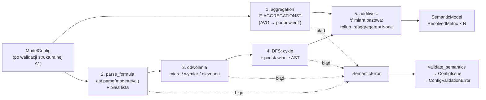

# A2 – AST domenowe, parser formuł, rejestry i rozwijanie zależności: notatka implementacyjna

## Co zostało zbudowane

- **`app/semantic/ast_nodes.py`** – AST domenowe (ADR-009): niemutowalne klasy danych (`frozen=True, slots=True`) `MeasureRef(name)`, `Literal(value)`, `BinaryOp(op, left, right)`, `UnaryOp(op, operand)`, `FunctionCall(name, args: tuple)`, unia `Expr`, generyczny `Visitor[T]` (rozdział przez `match` + `assert_never`, metody `visit_<węzeł>` abstrakcyjne), pomocnicze `measure_refs`, `walk` (pre-order) oraz `to_formula` – zapis tekstowy z minimalną liczbą nawiasów. Moduł nie importuje `sqlglot` (sprawdzane testem w osobnym procesie dla całej warstwy `app.semantic`).
- **`app/semantic/registry.py`** – rejestry (ADR-010/011): `AGGREGATIONS` (`AggregationSpec(name, rollup_reaggregate, description)`, właściwość `additive`) i `SCALAR_FUNCTIONS` (`FunctionSpec(name, min_args, max_args, description)`, metody `accepts`, `arity`), `FORBIDDEN_AGGREGATIONS` (AVG z podpowiedzią), `AGGREGATE_FUNCTION_NAMES` (do czytelnego błędu w formułach), funkcje `get_aggregation`, `get_scalar_function`, `is_additive`. Rejestry są widokami tylko do odczytu (`MappingProxyType`).
- **`app/semantic/formula_parser.py`** – `parse_formula(formula, metric) -> Expr`: `ast.parse(..., mode="eval")` + konwersja z białą listą węzłów.
- **`app/semantic/resolver.py`** – `analyze(config) -> Resolution(model | None, errors)` (zbiera wszystkie błędy) i `build_semantic_model(config) -> SemanticModel` (zgłasza pierwszy). `SemanticModel(config, metrics)` zawiera dla każdej miary bazowej i metryki pochodnej `ResolvedMetric(name, kind, formula, expanded, base_measures, additive)`; `get_metric(name)` z podpowiedzią przy nieznanej nazwie (przyda się w A3).
- **`app/semantic/validator.py`** – `validate_semantics(model) -> Iterator[ConfigIssue]`, adapter resolvera na interfejs walidatorów loadera; zarejestrowany w `SEMANTIC_VALIDATORS`.
- **`app/semantic/errors.py`** – hierarchia `SemanticError`: `FormulaSyntaxError`, `UnknownMeasureError`, `DimensionInFormulaError`, `CircularDependencyError`, `ConstantFormulaError`, `UnknownAggregationError`, funkcja `suggest` (podpowiedzi `difflib`).
- **`app/config/errors.py`** – `ConfigIssue` i `ConfigValidationError` przeniesione z loadera (loader je reeksportuje – istniejące importy działają bez zmian).
- **Testy** – `tests/semantic/` (156 przypadków po parametryzacji); test A1 sprawdzający pusty `SEMANTIC_VALIDATORS` zastąpiono testem rejestracji walidatora.

### Gramatyka dopuszczalnych formuł

```ebnf
expr    ::= term   ( ("+" | "-") term )*
term    ::= factor ( ("*" | "/") factor )*
factor  ::= "-" factor | atom
atom    ::= NUMBER | NAME | call | "(" expr ")"
call    ::= FUNC "(" [ expr ( "," expr )* ] ")"

NUMBER  ::= literał int lub float Pythona, skończony; bez bool, complex, napisów, None
NAME    ::= identyfikator ASCII – nazwa miary bazowej lub metryki pochodnej (nie wymiaru)
FUNC    ::= nazwa z SCALAR_FUNCTIONS, bez rozróżniania wielkości liter:
            ROUND (1–2 arg.), COALESCE (≥2), ABS (1), GREATEST (≥2), LEAST (≥2);
            bez argumentów nazwanych i rozpakowania (*args)
```

Priorytety i łączność są priorytetami Pythona (identycznymi jak w SQL dla tych operatorów): `*`/`/` wiążą silniej niż `+`/`-`, oba poziomy są lewostronnie łączne, minus jednoargumentowy wiąże najsilniej. Odpowiadające węzły modułu `ast`: `BinOp` z `Add|Sub|Mult|Div`, `UnaryOp` z `USub`, `Constant`, `Name`, `Call` z `func: Name`. Poza gramatyką (m.in.): atrybuty `a.b`, indeksowanie `a[0]`, `**`, `%`, `//`, operatory bitowe, porównania, `and`/`or`/`not`, jednoargumentowy `+`, napisy, `True`/`None`, lambdy, wyrażenia warunkowe, `:=`, listy/krotki/słowniki, comprehensions, f-stringi, wywołania agregacji (`SUM(a)`), wywołania niezarejestrowanych funkcji.

### Argument bezpieczeństwa białej listy

1. **Formuła nigdy nie jest wykonywana.** `ast.parse` buduje wyłącznie drzewo składniowe – nie kompiluje go do kodu bajtowego, nie rozwiązuje nazw, nie importuje modułów. `__import__('os')` jest dla parsera zwykłym węzłem `Call`, który zostaje odrzucony, bo `__import__` nie należy do `SCALAR_FUNCTIONS` (test `exit(1)` potwierdza, że wywołanie nie ma efektu ubocznego).
2. **Biała lista, nie czarna.** Konwerter rozpoznaje sześć typów węzłów; każdy inny (także węzły dodane w przyszłych wersjach Pythona) trafia do gałęzi domyślnej i kończy się błędem. Czarna lista musiałaby przewidzieć wszystkie niebezpieczne konstrukcje i starzałaby się wraz z językiem.
3. **Zamknięty alfabet wyniku.** Wynikiem jest AST domenowe złożone z pięciu klas o ściśle określonych polach: nazwy (identyfikatory ASCII, które resolver musi dopasować do zdefiniowanych miar), skończone liczby, cztery operatory i funkcje z rejestru. Do rendererów SQL (A3) nie przechodzi żaden fragment tekstu formuły – SQL zostanie zbudowany z węzłów `sqlglot`, a nazwy miar zastąpione wyrażeniami `sql` z sekcji `base_measures`. Wstrzyknięcie SQL przez pole `formula` jest więc niemożliwe konstrukcyjnie, a nie dzięki filtrowaniu napisów.
4. **Odporność na wejścia patologiczne.** Bardzo głębokie wyrażenia (np. 100 000 minusów) wywołują w parserze Pythona `RecursionError`/`SyntaxError` – oba są przechwytywane i zamieniane na `FormulaSyntaxError`, więc błędna konfiguracja nie przerywa procesu nieobsłużonym wyjątkiem.
5. **Zakres zagrożenia.** Formuły pochodzą z plików YAML autora modelu (zaufany, ale omylny autor), nie od użytkownika API. Biała lista chroni więc przede wszystkim przed pomyłkami (np. `SUM(x)/COUNT(y)` w formule, `**` zamiast `*`) i stanowi drugą linię obrony, gdyby konfiguracja pochodziła z mniej zaufanego źródła. Pola `sql` w YAML (wyrażenia BigQuery) nie są objęte tą gramatyką – ich bezpieczeństwo opiera się na zaufaniu do autora konfiguracji (zob. „Otwarte kwestie”).

## Decyzje nieopisane wprost w specyfikacji (decyzja, rozważone alternatywy, uzasadnienie)

1. **`Literal` jest nieujemny; negacja to zawsze `UnaryOp`.** Parser Pythona i tak zwraca `-2` jako `UnaryOp(USub, Constant(2))`. Niezmiennik daje jedną postać kanoniczną drzewa, dzięki czemu własność `parse(to_formula(x)) == x` zachodzi dla każdego poprawnie zbudowanego drzewa (sprawdzana także na 500 losowych drzewach). *Alternatywa:* zwijanie `-2` do `Literal(-2)` – dwie reprezentacje tej samej wartości komplikowałyby porównania i NULLIF-guard w A3 („niezerowy literał”). `Literal` odrzuca też `bool`, `inf` i `nan` (`1e999` w formule daje `inf` – odrzucane z komunikatem).
2. **`to_formula` zachowuje nawiasy po prawej stronie także dla `+` i `*`** (`a + (b + c)`), choć matematycznie są zbędne. Powód: arytmetyka zmiennoprzecinkowa nie jest łączna, a celem jest wierne odtworzenie drzewa. Dla `-(-a)` emitowane są nawiasy zamiast `--a` (czytelność; drzewo identyczne).
3. **Nazwy funkcji kanonizowane do wielkich liter w węźle** (`round(a)` → `FunctionCall("ROUND", …)`); nazwy miar porównywane dokładnie (z rozróżnieniem wielkości liter), a `Trips_Count` daje błąd z podpowiedzią `trips_count`. *Alternatywa:* dopasowanie bez wielkości liter – A1 zapewnia unikalność nazw z `casefold`, więc byłoby jednoznaczne, ale wprowadzałoby drugą pisownię tej samej miary w plikach konfiguracyjnych.
4. **Komunikaty błędów po angielsku**, jak w A1 (spójność całego `ConfigValidationError`). Treść podpowiedzi ze specyfikacji zachowano: „define aggregations in base_measures”, „define it as a derived metric SUM/COUNT”.
5. **Pozycja błędu w znakach, nie bajtach.** `col_offset` z modułu `ast` jest liczony w bajtach UTF-8; przeliczany jest na indeks znaku, a formuły wieloliniowe (blok YAML) – na pozycję bezwzględną. Białe znaki z brzegów formuły są pomijane przed parsowaniem (tryb `eval` odrzuca wcięcie na początku).
6. **Identyfikatory w formułach muszą być ASCII.** Python dopuszcza identyfikatory Unicode i normalizuje je NFKC; zgodnie z A1 nazwy miar są ASCII, więc nazwa spoza ASCII jest odrzucana od razu w parserze z precyzyjnym komunikatem.
7. **Formuła bez żadnej miary (np. `100`) jest błędem** (`ConstantFormulaError`). Taka „metryka” nie zależy od danych, a jej klasyfikacja dla routera (Warunek 3) byłaby umowna.
8. **Wykrywanie wymiarów w formułach w resolverze, nie w parserze** – parser nie zna modelu; resolver rozróżnia trzy przypadki nazwy: miara/metryka, wymiar (`DimensionInFormulaError`), nieznana (`UnknownMeasureError` z podpowiedzią spośród miar bazowych i metryk pochodnych).
9. **Zbieranie wszystkich błędów.** `analyze` raportuje błędy agregacji, składni, odwołań i cykli w jednym przebiegu (spójnie z A1). Metryka zależna od metryki błędnej nie generuje wtórnego komunikatu – zgłaszana jest tylko przyczyna. `build_semantic_model` zgłasza pierwszy błąd (wygodne w kodzie i testach), pełną listę daje walidator.
10. **Addytywność wyznacza resolver, nie walidator.** Wymaga jedynie rejestru agregacji i zbioru miar bazowych po rozwinięciu, więc jest częścią `ResolvedMetric`. Walidator jest cienkim adapterem (`SemanticError` → `ConfigIssue` ze ścieżką `base_measures.<m>.aggregation` lub `derived_metrics.<m>.formula`).
11. **Przeniesienie `ConfigIssue`/`ConfigValidationError` do `app/config/errors.py`.** Walidator semantyczny zwraca `ConfigIssue`, a loader importuje walidator – import w drugą stronę tworzyłby cykl (ryzyko odnotowane w notatce A1). *Alternatywy:* import leniwy wewnątrz funkcji lub rejestracja walidatora poza loaderem (np. w `app/__init__.py`) – obie mniej przejrzyste. Loader reeksportuje oba typy (`__all__`), więc API A1 się nie zmieniło. Dok. 03 (układ katalogów) zaktualizowano o `app/config/errors.py` i `app/semantic/errors.py`.
12. **Brak globalnego cache modelu semantycznego.** Spec. (Moduł 1 pkt 4) mówi o wyniku „cache'owanym per model”. `SemanticModel` jest niemutowalny i budowany jednorazowo funkcją `build_semantic_model`; przechowanie go obok `ModelConfig` (np. przy starcie aplikacji) zostawiono A3/A5. Klucz cache po `ModelConfig` nie jest możliwy wprost – model Pydantic z polami `dict` nie jest haszowalny. Konsekwencja: przy ładowaniu konfiguracji resolver wykonuje się dwa razy (walidator + budowa modelu) – koszt pomijalny (milisekundy).
13. **Punkt rozszerzenia renderowania per dialekt:** pole `dialect_renderers: Mapping[str, Callable[..., Any]]` w `AggregationSpec` i `FunctionSpec` (domyślnie puste, wyłączone z porównań i haszowania). Typ celowo ogólny – rejestr nie zna `sqlglot`; A3 może wstawić tam funkcje budujące węzły `sqlglot` lub zrezygnować z pola na rzecz mapowania w rendererze.
14. **`AGGREGATE_FUNCTION_NAMES`** – lista nazw agregacji SQL (także nieobsługiwanych: MEDIAN, STDDEV, PERCENTILE_CONT…) służy wyłącznie do komunikatu „agregacje definiuj w base_measures” zamiast mylącego „nieznana funkcja”.

## Napotkane problemy i sposób rozwiązania

- **Cykl importów loader ↔ walidator** – rozwiązany wydzieleniem `app/config/errors.py` (decyzja 11).
- **Bajty a znaki w `col_offset`** – decyzja 5. Ponieważ konwersja przebiega od lewej, a poprawny fragment formuły nie może zawierać znaków spoza ASCII, ścieżka ta jest osiągalna tylko z pomocniczej funkcji – testowana bezpośrednio.
- **Bajt NUL w formule** – w Pythonie 3.12+ `ast.parse` zgłasza `SyntaxError`, w 3.11 `ValueError`; obsłużone oba przypadki (gałąź 3.11 wyłączona z pokrycia, bo lokalnie działa 3.13).
- **Deduplikacja cykli okazała się zbędna** – po wykryciu cyklu każdy węzeł na jego ścieżce jest oznaczany jako błędny przy powrocie z rekurencji, więc ten sam cykl nie może zostać znaleziony ponownie z innego punktu startowego; początkowy kod deduplikujący usunięto.
- **Testy z importem `conftest`** wymagały pakietów `tests/__init__.py` i `tests/semantic/__init__.py`.

## Fragmenty kodu warte pokazania w pracy (ścieżka, ≤30 linii, dlaczego są istotne)

`app/semantic/formula_parser.py` – sedno białej listy: dopasowanie strukturalne `match` na węzłach modułu `ast`; gałąź domyślna odrzuca wszystko, czego nie wymieniono:

```python
def convert(self, node: ast.expr) -> Expr:
    match node:
        case ast.BinOp(left=left, op=op, right=right):
            symbol = _BINARY_OPS.get(type(op))          # tylko Add, Sub, Mult, Div
            if symbol is None:
                self._fail(node, f"operator '{_operator_name(op)}' is not allowed")
            return BinaryOp(symbol, self.convert(left), self.convert(right))
        case ast.UnaryOp(op=ast.USub(), operand=operand):
            return UnaryOp("-", self.convert(operand))
        case ast.UnaryOp(op=op):
            self._fail(node, f"operator '{_operator_name(op)}' is not allowed")
        case ast.Constant(value=value):
            return self._constant(node, value)          # int/float, bez bool, skończone
        case ast.Name(id=name):
            if not name.isascii():
                self._fail(node, f"name '{name}' must be an ASCII identifier")
            return MeasureRef(name)
        case ast.Call():
            return self._call(node)                     # tylko SCALAR_FUNCTIONS + arność
        case _:
            construct = _CONSTRUCT_NAMES.get(type(node), type(node).__name__)
            self._fail(node, f"{construct} is not allowed")
```

`app/semantic/resolver.py` – rozwijanie zależności: DFS z wykrywaniem cykli (zbiór „w trakcie odwiedzania” + ścieżka) i podstawianiem już rozwiniętych poddrzew visitorem `_Substituter`:

```python
def _expand(self, name: str) -> Expr | None:
    if name in self._base:
        return MeasureRef(name)
    if name in self._failed:
        return None
    if name in self._expanded:
        return self._expanded[name]
    if name in self._visiting:
        cycle = [*self._path[self._path.index(name) :], name]
        self._errors.append(CircularDependencyError(cycle))
        return None

    self._visiting.add(name)
    self._path.append(name)
    expr = self._parsed[name]
    children = {ref: self._expand(ref) for ref in _ordered_refs(expr)}
    self._path.pop()
    self._visiting.discard(name)

    resolved = {ref: child for ref, child in children.items() if child is not None}
    if len(resolved) != len(children):
        self._failed.add(name)
        return None
    expanded = substitute(expr, resolved)
    self._expanded[name] = expanded
    return expanded
```

Przykładowe rozwinięcie metryki wielopoziomowej (`to_formula(metric.expanded)`):

```
surcharge_to_revenue_roi_pct:  (non_fare_surcharges / total_revenue) * 100
  -> (total_revenue - total_fare_amount - total_tip_amount) / total_revenue * 100
  base_measures = {total_revenue, total_fare_amount, total_tip_amount}, additive = True
```

Przykładowy komunikat dla kilku błędów naraz:

```
Invalid configuration in 'configs/nyc_taxi.yaml':
  - base_measures.total_tip_amount.aggregation: aggregation 'AVG' is not supported; define it as a derived metric SUM/COUNT (e.g. total_x / count_x)
  - derived_metrics.x.formula: only calls of registered scalar functions are allowed in '__import__("os").system("ls")' at column 17 of formula 'total_revenue + __import__("os").system("ls")'
      total_revenue + __import__("os").system("ls")
                      ^
  - derived_metrics.w.formula: unknown measure or metric 'total_revnue'; did you mean 'total_revenue'?
  - derived_metrics.y.formula: circular dependency: y -> z -> y
```

## Diagram (Mermaid), jeśli pomaga zrozumieć etap



## Liczby (liczba testów, pokrycie, rozmiar modułów)

- Testy: **206** łącznie (50 z A1 + **156** nowych w `tests/semantic/`: `test_ast_nodes` 33, `test_formula_parser` 68, `test_registry` 17, `test_resolver` 24, `test_validator` 14), wszystkie zielone; czas ok. 1 s.
- Pokrycie (`pytest-cov`, z gałęziami) dla `app/`: **99%** – jedyna niepokryta gałąź to obsługa `SyntaxError` bez numeru linii (defensywna); gałąź `ValueError` dla Pythona 3.11 wyłączona z pomiaru.
- Rozmiar (linie): `ast_nodes.py` 252, `formula_parser.py` 222, `resolver.py` 280, `registry.py` 175, `errors.py` 118, `validator.py` 36, `app/config/errors.py` 36; testy `tests/semantic/` ok. 840.
- `ruff check`, `ruff format --check`, `mypy app` (strict dla `app.semantic`, `app.config`) – bez błędów; `mypy tests` również przechodzi.

## Otwarte kwestie / ryzyka dla kolejnych etapów

- **A3 – NULLIF guard:** spec. przewiduje wyjątek dla „niezerowego `Literal`”. Dzięki niezmiennikowi nieujemności dzielnik `-3600.0` to `UnaryOp("-", Literal(3600.0))` – renderer powinien traktować także taki węzeł jako stały niezerowy (lub konsekwentnie owijać go `NULLIF`, co jest poprawne, ale mniej czytelne). Dzielenie przez `Literal(0)` przechodzi walidację A2 – decyzja w A3.
- **A3 – `dialect_renderers`:** pole istnieje, ale nie ma jeszcze ustalonego kontraktu wywołania; A3 ustala sygnaturę albo pole usuwa. `COUNT_DISTINCT` → `COUNT(DISTINCT …)` to również decyzja renderera.
- **A3/A5 – przechowywanie `SemanticModel`:** rejestr modeli z A1 przechowuje `ModelConfig`; trzeba zdecydować, czy rejestr zwraca pary (`ModelConfig`, `SemanticModel`), czy model semantyczny jest budowany przy starcie API (decyzja 12).
- **Pola `sql` w YAML** nie są walidowane gramatycznie w A2 (to fragmenty BigQuery parsowane w A3 przez `sqlglot`). Złośliwy autor konfiguracji mógłby tam umieścić podzapytanie; jeśli konfiguracje mają pochodzić z mniej zaufanych źródeł, A3 powinno ograniczyć dopuszczalne węzły `sqlglot` (analogiczna biała lista).
- **Rozszerzenia języka formuł** (np. `CASE`/`IF`) wymagają nowej klasy węzła, rozszerzenia unii `Expr` i metod we wszystkich visitorach – `mypy` (`assert_never`) i `ABC` wskażą brakujące miejsca.
