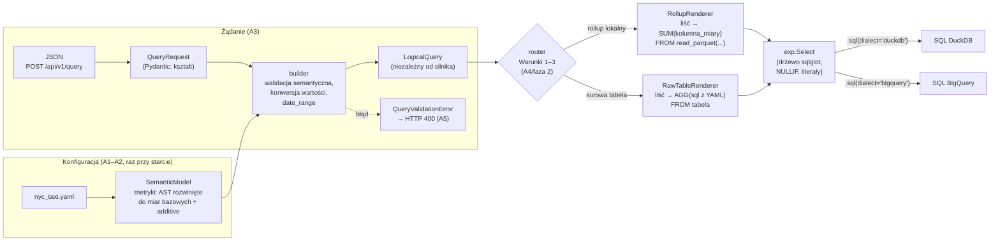

# A3 – Plan logiczny i renderery SQL: notatka implementacyjna

## Co zostało zbudowane

- **`app/api/models.py`** – modele Pydantic żądania `POST /api/v1/query` (dok. 03, sekcja 4): `QueryRequest`, `Filter`, `OrderBy`, `ExecutionControl` (`execution_mode ∈ {auto, force_duckdb, force_bigquery}`, `include_telemetry`, `confirm_high_cost`). Modele są niemutowalne, odrzucają nieznane klucze i używają typów ścisłych (`true` nie staje się liczbą 1, `"10"` nie staje się limitem). Modele odpowiedzi pozostawiono etapowi A5.
- **`app/planner/logical_plan.py`** – niemutowalny plan logiczny `LogicalQuery` (ADR-008) z klasami pomocniczymi `PlannedDimension`, `PlannedMetric`, `PlannedFilter`, `PlannedOrder`. Plan zawiera: wymiary z definicjami z YAML, metryki z AST rozwiniętym do miar bazowych i flagą `additive`, filtry z wartościami skonwertowanymi do typu wymiaru, sortowanie, limit, `date_range`, definicje użytych miar bazowych (`base_measures`, właściwość `used_base_measures`), `used_dimensions` (z `dimensions`, `filters` i `order_by`) oraz `partition_key`. Plan nie zawiera tekstu SQL ani węzłów `sqlglot`.
- **`app/planner/builder.py`** – `build_logical_query(request, models)` (wybór modelu z rejestru) i `plan_query(request, model)`: walidacja zapytania względem modelu semantycznego, konwersja wartości filtrów, wyznaczanie zakresu dat (`compute_date_range`).
- **`app/planner/errors.py`** – hierarchia `QueryValidationError` (pole `field` ze ścieżką w żądaniu, np. `filters[2].op`, oraz `error_type` = nazwa klasy – pod mapowanie na HTTP 400 w A5): `UnknownModelError`, `UnknownDimensionError`, `UnknownMetricError`, `FilterOnMetricError`, `UnsupportedOperatorError`, `InvalidFilterValueError`, `EmptyDateRangeError`, `OrderByFieldNotSelectedError`, `DuplicateFieldError`, `EmptyMetricsError`, `InvalidLimitError`.
- **`app/renderers/base.py`** – `SqlRenderer` (wzorzec *Template Method*: wspólny szkielet `SELECT … FROM … WHERE … GROUP BY … ORDER BY … LIMIT`, podklasy dostarczają `source`, `dimension_expr`, `measure_expr`), visitor `MetricExprBuilder` (AST domenowe → `sqlglot`, NULLIF guard, nawiasy, funkcje skalarne), rejestry builderów `AGGREGATE_BUILDERS` i `SCALAR_FUNCTION_BUILDERS`, literały filtrów, parsowanie fragmentów `sql` z YAML (`read="bigquery"`, cache + kopia). API: `build(plan, dialect=None) -> exp.Select`, `render(plan, dialect, pretty=False) -> str`.
- **`app/renderers/raw_table.py`** – `RawTableRenderer(source_table)`: liść → `AGG(<sql z YAML>)` (`COUNT_DISTINCT` → `COUNT(DISTINCT …)`), wymiar → wyrażenie `sql` aliasowane nazwą.
- **`app/renderers/rollup.py`** – `RollupRenderer(parquet_glob)`: `FROM read_parquet('<glob>', hive_partitioning = true)`, liść → funkcja re-agregacji na kolumnie miary, wymiar → nazwa kolumny; funkcje `rollup_glob(base_path, partition_key)` i `rollup_glob_for(local_cache)`.
- **`app/renderers/errors.py`** – błędy programistyczne rendererów: `NonAdditiveMeasureError`, `DimensionNotInRollupError`, `SqlFragmentError`, `UnsupportedFunctionError`.
- **Zmiana w warstwie semantycznej (A2):** nowy błąd konfiguracji `DivisionByZeroLiteralError` (formuła dzieląca przez stałą zero) w resolverze; doprecyzowany kontrakt pola `dialect_renderers` w rejestrze.
- **Testy** – `tests/api/` (20), `tests/planner/` (60), `tests/renderers/` (94, w tym 17 przypadków golden SQL), `tests/semantic/test_resolver.py` (+4); wspólny `tests/conftest.py` z modelem `nyc_taxi.yaml` i przykładowym żądaniem z dok. 03.
- **Specyfikacja:** dok. 03 zaktualizowany – układ katalogów (`planner/errors.py`, `renderers/errors.py`, builder przyjmuje `SemanticModel`), doprecyzowanie wyjątku NULLIF (stała ujemna, dzielenie przez stałą zero) i postaci `NOT IN`.

## Decyzje nieopisane wprost w specyfikacji (decyzja, rozważone alternatywy, uzasadnienie)

1. **Podział walidacji żądania: kształt (Pydantic) vs semantyka (builder).** Pydantic sprawdza typy JSON, nieznane klucze, `execution_mode` i `direction` (`Literal`). Wszystko, co wymaga modelu semantycznego – nazwy wymiarów i metryk, operator, zgodność wartości z typem wymiaru, `limit > 0`, niepusta lista metryk – sprawdza builder. *Alternatywa:* `op: Literal[...]` i `limit: PositiveInt` w Pydantic. *Uzasadnienie:* prompt etapu wymaga tych błędów w builderze, a jeden typ `QueryValidationError` z precyzyjnym `error_type` i podpowiedzią („allowed: '==', '!=', …”) jest czytelniejszy od ogólnego błędu walidacji Pydantic.
2. **Builder przyjmuje `SemanticModel`, nie `ModelConfig`.** Rozwinięte AST metryk i addytywność są gotowe w modelu semantycznym (A2), więc builder ich nie przelicza. `build_logical_query` przyjmuje rejestr `Mapping[str, SemanticModel]` – to częściowo rozstrzyga otwartą kwestię z A2: A5 powinno przy starcie zbudować model semantyczny dla każdego `ModelConfig` i przechowywać rejestr modeli semantycznych.
3. **Zgłaszany jest pierwszy błąd** (inaczej niż w A1/A2, gdzie zbierano wszystkie). Żądanie API jest krótkie, a A5 ma zwracać jeden `error_type`; pole `field` wskazuje dokładnie element żądania.
4. **Duplikaty są błędem** (`DuplicateFieldError`) w `dimensions`, `metrics` i `order_by` – zduplikowany alias w `SELECT` dawałby niejednoznaczny wynik.
5. **Konwersja wartości filtrów.** `date`: wyłącznie napis `YYYY-MM-DD` (Python 3.11+ `date.fromisoformat` przyjmuje też `20221201` czy `2022-W48-4` – ograniczono to wyrażeniem regularnym). `number`: `int`/`float` lub napis liczbowy (`"3"` → `3`, `" 4.25 "` → `4.25`), bez `nan`/`inf`. `string`: napis lub liczba całkowita (`2` → `"2"`); liczba zmiennoprzecinkowa jest odrzucana, bo jej zapis tekstowy jest niejednoznaczny (`"1"` vs `"1.0"`). Wartości logiczne i `null` odrzuca już model Pydantic.
6. **Zakres dat.** Granice z wielu filtrów są przecinane (`AND`): `>=`/`>` podnoszą dolną granicę (`>` o jeden dzień), `<=`/`<` obniżają górną, `==` ustala obie, `in` – przedział `[min, max]` listy. `!=` i `not_in` nie zawężają zakresu. Dla `in` przedział jest nadzbiorem faktycznie odpytywanych dni – router może przez to uznać za brakujący dzień, o który zapytanie nie pyta (bezpieczny fallback, nigdy błędny wynik). Filtry wzajemnie sprzeczne (pusty przedział, także `> 9999-12-31`) dają `EmptyDateRangeError` (HTTP 400). *Alternatywa:* poprawne zapytanie z pustym wynikiem. *Uzasadnienie:* sprzeczne granice daty to niemal zawsze pomyłka klienta, a typ `tuple[date, date]` nie ma naturalnej reprezentacji pustego zakresu.
7. **Plan przenosi definicje miar bazowych.** Spec. daje `RawTableRenderer` tylko nazwę tabeli, więc wyrażenia `sql` i agregacje liści muszą pochodzić z planu (`LogicalQuery.base_measures`). Dzięki temu renderery nie zależą od `ModelConfig`, a `used_base_measures` (Warunek 3) jest po prostu zbiorem kluczy. `used_dimensions` jest mapowaniem nazwa → `PlannedDimension`, więc router odczyta `in_rollup` bez sięgania do konfiguracji (Warunek 1).
8. **Nawiasy wynikają z kształtu AST, nie z priorytetów.** Każdy argument operatora, który sam jest operatorem dwuargumentowym, jest opakowywany w `exp.Paren`. *Alternatywa:* nawiasy minimalne wg priorytetów. *Uzasadnienie:* generator `sqlglot` nie dodaje nawiasów sam dla węzłów budowanych ręcznie (`Mul(Add(a, b), c)` dałoby `a + b * c`), reguła „zawsze” jest trywialnie poprawna i daje dokładnie postać z dok. 03: `(SUM(a) / NULLIF(SUM(b), 0)) * 100` oraz `NULLIF((SUM(d) / 3600.0), 0)`.
9. **NULLIF – stałe.** „Niezerowy literał” obejmuje także `UnaryOp("-", Literal(x≠0))` (w AST z A2 literał jest zawsze nieujemny, więc `/ -3600.0` to `UnaryOp`). Dzielenie przez **literał 0** – decyzja podwójna: (a) renderer jest totalny i owija go `NULLIF(0, 0)` (wynik `NULL`, spójny z semantyką „dzielenie przez zero = NULL”), (b) walidacja konfiguracji odrzuca taką formułę (`DivisionByZeroLiteralError`), bo metryka stale równa `NULL` jest pomyłką autora. Dzielenie przez funkcję ze stałą (`/ ABS(5)`) jest chronione – renderer nie wylicza wartości funkcji.
10. **`WHERE` i `GROUP BY` na pełnych wyrażeniach, `ORDER BY` na aliasach.** W `RawTableRenderer` alias wymiaru często pokrywa się z nazwą kolumny źródłowej (`CAST(vendor_id AS STRING) AS vendor_id`); w `WHERE` aliasy są niedozwolone, a w `GROUP BY` DuckDB wiąże nazwę najpierw z kolumną źródłową. `ORDER BY` wiąże się z aliasem `SELECT` w obu silnikach (sprawdzone w DuckDB 2.0) i jest jedynym sposobem odwołania do metryki bez powtarzania agregatu.
11. **Jawne `NULLS LAST`.** Domyślne położenie `NULL` różni się: BigQuery `ASC` → NULLS FIRST, DuckDB → NULLS LAST. Przy `LIMIT` decyduje to o tym, które wiersze trafią do wyniku, więc wynik zależałby od silnika wybranego przez router. Węzeł `Ordered` ma `nulls_first=False`; generator `sqlglot` dopisuje `NULLS LAST` tylko tam, gdzie nie jest domyślne (BigQuery `ASC`).
12. **GREATEST/LEAST z semantyką BigQuery.** BigQuery zwraca `NULL`, gdy którykolwiek argument jest `NULL`; DuckDB `NULL` pomija. Węzły budowane są z `ignore_nulls=False`, a generator dla DuckDB dopisuje `CASE WHEN a IS NULL OR b IS NULL THEN NULL ELSE GREATEST(a, b) END`. Formuła ma więc jedną semantykę niezależnie od silnika (istotne, bo NULLIF celowo wprowadza `NULL`).
13. **Kontrakt punktu rozszerzenia `dialect_renderers` (z A2).** Wpis `{"duckdb": f}` w `FunctionSpec` nadpisuje renderowanie funkcji dla jednego dialektu; `f(args: Sequence[exp.Expr]) -> exp.Expr`. Kolejność: nadpisanie dla dialektu → `SCALAR_FUNCTION_BUILDERS` → `exp.func(nazwa, …)` (typowany węzeł `sqlglot`, np. `exp.Round`). Dlatego `build(plan, dialect=None)` ma opcjonalny dialekt – bez nadpisań drzewo jest niezależne od dialektu, a dialekt działa dopiero w `.sql(dialect=…)`. Agregacje renderuje `AGGREGATE_BUILDERS` (rejestr nazw z `AGGREGATIONS`).
14. **`DimensionNotInRollupError`** obok wymaganego `NonAdditiveMeasureError` – `RollupRenderer` odmawia także wymiaru z `in_rollup: false` (w `SELECT` lub filtrze). Oba błędy oznaczają, że router przepuścił plan łamiący Warunek 1 lub 3, więc mają osobną hierarchię `RendererError` (błąd programistyczny → HTTP 500, nie 400).
15. **Fragmenty `sql` z YAML:** parsowane raz (`lru_cache`), do drzewa trafia zawsze **kopia** (węzły `sqlglot` są mutowalne i znają rodzica). Błąd parsowania → `SqlFragmentError` z nazwą wymiaru/miary. Nazwa tabeli surowej parsowana w notacji BigQuery (`projekt.zbiór.tabela`, także z myślnikami).
16. **Golden SQL w plikach `.sql`** (`tests/renderers/golden/<przypadek>.<wariant>.sql`), porównywanych po normalizacji `parse_one(...).sql(dialect, pretty=True)`. Pliki są czytelnym materiałem do pracy; regeneracja: `UPDATE_GOLDEN=1 poetry run pytest tests/renderers/test_golden.py` + przegląd `git diff`. Dodatkowy test porównuje wynik `RollupRenderer@duckdb` z dosłownym `compiled_sql` z dok. 03 – zgodny.

## Napotkane problemy i sposób rozwiązania

- **`TIMESTAMP_DIFF(..., SECOND)` w DuckDB – różnica semantyczna (zgłoszona autorowi, nie obchodzona).** `sqlglot` 30.27 transpiluje `TIMESTAMP_DIFF(dropoff_datetime, pickup_datetime, SECOND)` na `DATE_DIFF('SECOND', pickup_datetime, dropoff_datetime)` – kolejność argumentów poprawna, ale funkcje liczą co innego: DuckDB `DATE_DIFF` zlicza **przekroczone granice** jednostki, BigQuery `TIMESTAMP_DIFF` **obcina różnicę**. Sprawdzone w DuckDB 2.0: `00:00:00.9 → 00:00:01.1` daje w DuckDB `1`, w BigQuery `0`. Dla znaczników z dokładnością do pełnych sekund (NYC TLC) wyniki są identyczne (`00:00:00 → 00:10:05` = 605 w obu, przejazd przez północ = 120). Test `test_bigquery_fragments_transpile_to_duckdb` utrwala obecne zachowanie – aktualizacja `sqlglot` zmieniająca transpilację zostanie zauważona.
- **`CAST(x AS STRING)`** → `CAST(x AS TEXT)` w DuckDB – poprawne (`TEXT` = `VARCHAR`); `DATE(ts)` → `CAST(ts AS DATE)` – poprawne dla `TIMESTAMP` bez strefy.
- **`sqlglot` 30 zmienił klasę bazową węzłów:** wspólnym typem jest `exp.Expr` (`exp.Expression` jest jego podklasą, a `exp.Binary`/`exp.Func` już nie). Adnotacje używają `exp.Expr`, inaczej `mypy --strict` odrzuca zwracane węzły.
- **Generator BigQuery przepisuje `GROUP BY`:** gdy zapytanie ma `ORDER BY`, `sqlglot` zastępuje w `GROUP BY` wyrażenia ich aliasami (`GROUP BY pickup_date, vendor_id` zamiast `GROUP BY DATE(pickup_datetime), …`); bez `ORDER BY` zostawia wyrażenia (por. pliki golden `spec_example` i `in_not_in`). Oba warianty są w BigQuery poprawne i równoważne; do potwierdzenia `dry_run` w fazie 2.
- **`not_in`** jest generowane jako `NOT x IN (…)` – kanoniczna postać `sqlglot`, semantycznie równa `x NOT IN (…)` (spec. zaktualizowana).
- **Podwójny minus:** `-(-a)` mogłoby dać `--a`, czyli komentarz SQL. Generator `sqlglot` wstawia spację (`- -SUM(…)`); test to utrwala.

## Fragmenty kodu warte pokazania w pracy (ścieżka, ≤30 linii, dlaczego są istotne)

`app/renderers/base.py` – NULLIF guard i nawiasy w visitorze AST domenowego; całe „bezpieczeństwo arytmetyczne” to kilka linii, bo działa na drzewie, a nie na tekście:

```python
def is_nonzero_constant(expr: Expr) -> bool:
    match expr:
        case Literal(value=value):
            return value != 0
        case UnaryOp(operand=operand):
            return is_nonzero_constant(operand)
        case _:
            return False


class MetricExprBuilder(Visitor[exp.Expr]):
    def visit_measure_ref(self, node: MeasureRef) -> exp.Expr:
        return self._leaf(node.name)          # SUM(fare_amount) albo SUM(total_fare_amount)

    def visit_binary_op(self, node: BinaryOp) -> exp.Expr:
        left = self._operand(node.left)
        right = self._operand(node.right)
        if node.op == "/" and not is_nonzero_constant(node.right):
            right = exp.Nullif(this=right, expression=exp.Literal.number(0))
        return _ARITHMETIC[node.op](this=left, expression=right)

    def _operand(self, node: Expr) -> exp.Expr:
        rendered = self.visit(node)
        return exp.Paren(this=rendered) if isinstance(node, BinaryOp) else rendered
```

`app/renderers/rollup.py` vs `app/renderers/raw_table.py` – jedyna różnica między ścieżką „surową” a „rollupową” to postać liścia i wymiaru (ADR-008):

```python
class RawTableRenderer(SqlRenderer):
    def dimension_expr(self, dimension):
        return parse_fragment(dimension.definition.sql, dimension.name)   # CAST(vendor_id AS STRING)
    def measure_expr(self, name, measure):
        return aggregate(measure.aggregation, parse_fragment(measure.sql, name))  # SUM(fare_amount)

class RollupRenderer(SqlRenderer):
    def dimension_expr(self, dimension):
        if not dimension.in_rollup:
            raise DimensionNotInRollupError(dimension.name)
        return exp.column(dimension.name)                                  # vendor_id
    def measure_expr(self, name, measure):
        spec = get_aggregation(measure.aggregation)
        if spec.rollup_reaggregate is None:
            raise NonAdditiveMeasureError(name, spec.name)                 # COUNT_DISTINCT
        return aggregate(spec.rollup_reaggregate, exp.column(name))        # SUM(total_fare_amount)
```

`app/renderers/base.py` – szkielet zapytania budowany z węzłów (bez konkatenacji napisów):

```python
def build(self, plan: LogicalQuery, dialect: str | None = None) -> exp.Select:
    builder = MetricExprBuilder(lambda name: self._leaf(plan, name), dialect)
    projections = [self.select_dimension(d) for d in plan.dimensions]
    projections += [exp.alias_(builder.visit(m.expr), m.name) for m in plan.metrics]

    select = exp.Select(expressions=projections).from_(self.source(), copy=False)
    if plan.filters:
        conditions = [condition(self.dimension_expr(f.dimension), f) for f in plan.filters]
        select = select.where(exp.and_(*conditions), copy=False)
    if plan.dimensions:
        select = select.group_by(*(self.dimension_expr(d) for d in plan.dimensions), copy=False)
    if plan.order_by:
        select = select.order_by(*(self.order_expr(o) for o in plan.order_by), copy=False)
    if plan.limit is not None:
        select = select.limit(plan.limit, copy=False)
    return select
```

Ochrona przed SQL injection (test `test_filter_values_are_safe_literals`): wartość `x'; DROP TABLE raw_trips; --` trafia do drzewa jako `exp.Literal.string(...)`; generator escapuje apostrof według reguł dialektu (`'x''; DROP …'` w DuckDB, `'x\'; DROP …'` w BigQuery). Test parsuje wygenerowany SQL ponownie i sprawdza, że jest dokładnie jedno zapytanie, `WHERE` ma dokładnie dwa warunki, a literały mają oryginalną wartość – dla 7 złośliwych wartości × 3 warianty.

## Diagram (Mermaid), jeśli pomaga zrozumieć etap



Jedyne miejsce transpilacji międzydialektowej to fragmenty `sql` z YAML (`parse_one(..., read="bigquery")` wewnątrz `RawTableRenderer`) – pełny tekst zapytania nigdy nie jest parsowany ponownie.

## Przykład: jedno zapytanie w trzech wariantach

Żądanie z dok. 03, sekcja 4 (wymiary `pickup_date`, `vendor_id`; metryki `trips_count`, `total_revenue`, `tip_to_fare_ratio_pct`, `avg_trip_speed_mph`; filtry na dacie 2022-12-01..23 i `payment_type = '1'`; sortowanie po dacie, limit 1000). Plan logiczny: `date_range = (2022-12-01, 2022-12-23)`, `used_dimensions = {pickup_date, vendor_id, payment_type}`, `used_base_measures = {trips_count, total_revenue, total_tip_amount, total_fare_amount, total_distance_miles, total_duration_seconds}`, wszystkie metryki addytywne.

Porównanie elementów (pełny SQL poniżej i w `tests/renderers/golden/spec_example.*.sql`):

| Element | RollupRenderer @ DuckDB | RawTableRenderer @ BigQuery | RawTableRenderer @ DuckDB |
|---|---|---|---|
| wymiar `pickup_date` | `pickup_date` | `DATE(pickup_datetime) AS pickup_date` | `CAST(pickup_datetime AS DATE) AS pickup_date` |
| wymiar `vendor_id` | `vendor_id` | `CAST(vendor_id AS STRING) AS vendor_id` | `CAST(vendor_id AS TEXT) AS vendor_id` |
| `trips_count` (COUNT) | `SUM(trips_count)` | `COUNT(1)` | `COUNT(1)` |
| `tip_to_fare_ratio_pct` | `(SUM(total_tip_amount) / NULLIF(SUM(total_fare_amount), 0)) * 100` | `(SUM(tip_amount) / NULLIF(SUM(fare_amount), 0)) * 100` | j.w. |
| mianownik `avg_trip_speed_mph` | `NULLIF((SUM(total_duration_seconds) / 3600.0), 0)` | `NULLIF((SUM(TIMESTAMP_DIFF(dropoff_datetime, pickup_datetime, SECOND)) / 3600.0), 0)` | `NULLIF((SUM(DATE_DIFF('SECOND', pickup_datetime, dropoff_datetime)) / 3600.0), 0)` |
| `FROM` | `READ_PARQUET('./data/nyc_taxi/pickup_date=*/rollup.parquet', hive_partitioning = TRUE)` | `bigquery-public-data.new_york_taxi_trips.tlc_yellow_trips_2022` | `raw_trips` |
| filtr daty | `pickup_date >= CAST('2022-12-01' AS DATE)` | `DATE(pickup_datetime) >= CAST('2022-12-01' AS DATE)` | `CAST(pickup_datetime AS DATE) >= CAST('2022-12-01' AS DATE)` |
| `GROUP BY` | `pickup_date, vendor_id` | `pickup_date, vendor_id` (alias – przepisane przez generator BQ) | `CAST(pickup_datetime AS DATE), CAST(vendor_id AS TEXT)` |
| `ORDER BY` | `pickup_date ASC` | `pickup_date ASC NULLS LAST` | `pickup_date ASC` |

**RollupRenderer @ DuckDB** (identyczny z `compiled_sql` z dok. 03 po normalizacji):

```sql
SELECT
  pickup_date,
  vendor_id,
  SUM(trips_count) AS trips_count,
  SUM(total_revenue) AS total_revenue,
  (SUM(total_tip_amount) / NULLIF(SUM(total_fare_amount), 0)) * 100 AS tip_to_fare_ratio_pct,
  SUM(total_distance_miles) / NULLIF((SUM(total_duration_seconds) / 3600.0), 0) AS avg_trip_speed_mph
FROM READ_PARQUET('./data/nyc_taxi/pickup_date=*/rollup.parquet', hive_partitioning = TRUE)
WHERE
  pickup_date >= CAST('2022-12-01' AS DATE)
  AND pickup_date <= CAST('2022-12-23' AS DATE)
  AND payment_type = '1'
GROUP BY pickup_date, vendor_id
ORDER BY pickup_date ASC
LIMIT 1000
```

**RawTableRenderer @ BigQuery:**

```sql
SELECT
  DATE(pickup_datetime) AS pickup_date,
  CAST(vendor_id AS STRING) AS vendor_id,
  COUNT(1) AS trips_count,
  SUM(total_amount) AS total_revenue,
  (SUM(tip_amount) / NULLIF(SUM(fare_amount), 0)) * 100 AS tip_to_fare_ratio_pct,
  SUM(trip_distance) / NULLIF((
    SUM(TIMESTAMP_DIFF(dropoff_datetime, pickup_datetime, SECOND)) / 3600.0
  ), 0) AS avg_trip_speed_mph
FROM bigquery-public-data.new_york_taxi_trips.tlc_yellow_trips_2022
WHERE
  DATE(pickup_datetime) >= CAST('2022-12-01' AS DATE)
  AND DATE(pickup_datetime) <= CAST('2022-12-23' AS DATE)
  AND CAST(payment_type AS STRING) = '1'
GROUP BY pickup_date, vendor_id
ORDER BY pickup_date ASC NULLS LAST
LIMIT 1000
```

**RawTableRenderer @ DuckDB** (ścieżka „surowa” testów różnicowych A4):

```sql
SELECT
  CAST(pickup_datetime AS DATE) AS pickup_date,
  CAST(vendor_id AS TEXT) AS vendor_id,
  COUNT(1) AS trips_count,
  SUM(total_amount) AS total_revenue,
  (SUM(tip_amount) / NULLIF(SUM(fare_amount), 0)) * 100 AS tip_to_fare_ratio_pct,
  SUM(trip_distance) / NULLIF((
    SUM(DATE_DIFF('SECOND', pickup_datetime, dropoff_datetime)) / 3600.0
  ), 0) AS avg_trip_speed_mph
FROM raw_trips
WHERE
  CAST(pickup_datetime AS DATE) >= CAST('2022-12-01' AS DATE)
  AND CAST(pickup_datetime AS DATE) <= CAST('2022-12-23' AS DATE)
  AND CAST(payment_type AS TEXT) = '1'
GROUP BY CAST(pickup_datetime AS DATE), CAST(vendor_id AS TEXT)
ORDER BY pickup_date ASC
LIMIT 1000
```

Ten sam plan i to samo AST metryki (`total_tip_amount / total_fare_amount * 100`) dają trzy zapytania różniące się wyłącznie postacią liści, wymiarów, źródła i składnią dialektu – struktura arytmetyki i ochrona dzielenia są identyczne. Na tym opiera się „złota zasada” (dok. 02): rollup przechowuje sumy dzienne, a dzielenie wykonywane jest dopiero po zsumowaniu całego zakresu.

## Liczby (liczba testów, pokrycie, rozmiar modułów)

- Testy: **384** łącznie (206 z A1–A2 + **178** nowych: `tests/api/test_models.py` 20, `tests/planner/test_builder.py` 60, `tests/renderers/test_renderers.py` 74, `tests/renderers/test_golden.py` 20 (17 golden + 3 pomocnicze), `tests/semantic/test_resolver.py` +4), wszystkie zielone; czas ok. 2–4 s (z pomiarem pokrycia).
- Golden SQL: 6 przypadków (przykład z dok. 03, metryka wielopoziomowa, ROUND, `in`/`not_in`/`!=`, brak filtrów i wymiarów, miara holistyczna) × 3 warianty, minus wariant rollupowy miary holistycznej (sprawdzany jako błąd) = **17 plików `.sql`**.
- Pokrycie (`pytest-cov`, z gałęziami) dla `app/`: **99%** (0 niepokrytych instrukcji; 3 częściowe gałęzie – wyczerpujące `match` na typach `Literal`).
- Rozmiar (linie): `planner/builder.py` 329, `planner/logical_plan.py` 124, `planner/errors.py` 109, `renderers/base.py` 326, `renderers/rollup.py` 70, `renderers/raw_table.py` 37, `renderers/errors.py` 49, `api/models.py` 68; testy A3 ok. 1260.
- `ruff check`, `ruff format --check`, `mypy app tests` (strict dla `app.planner`, `app.renderers`) – bez błędów.

## Otwarte kwestie / ryzyka dla kolejnych etapów

- **`TIMESTAMP_DIFF` w DuckDB – zaakceptowane przez autora.** Różnica jest ograniczona: DuckDB liczy `floor(b) − floor(a)`, BigQuery `trunc(b − a)`; ponieważ części ułamkowe różnią się o mniej niż 1 s, wynik DuckDB jest równy wynikowi BigQuery albo większy o dokładnie 1 s – na pojedynczy przejazd, nigdy mniejszy. W mierze `total_duration_seconds` (SUM) błąd kumuluje się do co najwyżej N sekund dla N przejazdów, ale wyłącznie przy znacznikach z ułamkami sekund. Praktyczny wpływ jest zerowy: dane NYC TLC mają dokładność sekundową, rollupy w fazie 2 liczy BigQuery (semantyka BigQuery), a ścieżka raw@DuckDB służy tylko testom różnicowym, w których obie strony liczą w DuckDB. Generator syntetyczny A4 powinien mimo to generować pełne sekundy. Gdyby w przyszłości pojawiły się dane z ułamkami sekund – transformacja per dialekt w rendererze (np. obcięcie różnicy epok).
- **A4:** `rollup_query` powinien użyć `RawTableRenderer.dimension_expr` / `measure_expr` (te same fragmenty i agregacje), a `check_local_eligibility` – pól planu `used_dimensions[...].in_rollup`, `date_range`, `used_base_measures` + `additive` metryk. Router musi gwarantować, że do `RollupRenderer` nie trafi plan łamiący Warunek 1 lub 3 (inaczej `RendererError`).
- **A5:** mapowanie `QueryValidationError` → 400 (`error_type`, `field`, `message`), `RendererError` → 500; rejestr `SemanticModel` budowany przy starcie; `compiled_sql` do telemetrii z `render(plan, dialect)`.
- **Fragmenty `sql` nie są walidowane przy ładowaniu konfiguracji** – błąd składni wychodzi dopiero przy renderowaniu (`SqlFragmentError`). Warto dodać walidator konfiguracji parsujący wszystkie fragmenty (i ewentualnie białą listę węzłów `sqlglot`, np. zakaz podzapytań – ryzyko z notatki A2). Rejestracja powinna nastąpić poza `app.semantic` (warstwa semantyczna nie zna `sqlglot`).
- **Strefa czasowa `DATE(ts)`:** BigQuery liczy `DATE(TIMESTAMP)` w UTC, DuckDB `CAST(TIMESTAMPTZ AS DATE)` w strefie sesji. Dla `TIMESTAMP` bez strefy (dane syntetyczne) wyniki są zgodne; w fazie 2 należy sprawdzić typ `pickup_datetime` w tabeli publicznej.
- **Faza 2 (`dry_run`):** potwierdzić, że BigQuery akceptuje nazwę tabeli z myślnikami bez cytowania oraz `GROUP BY` po aliasie równym nazwie kolumny źródłowej (przepisanie wykonuje generator `sqlglot`).
- **Remisy przy `ORDER BY` + `LIMIT`** – kolejność wierszy o równym kluczu sortowania nie jest deterministyczna w żadnym silniku; porównania wyników DuckDB vs BigQuery z `LIMIT` powinny sortować po wszystkich wymiarach.
- **Zależność `app.planner` → `app.api.models`:** builder przyjmuje `QueryRequest` (zgodnie ze spec.), więc planer zależy od modelu API. Jeśli pojawi się drugi klient planera (np. benchmarki bez HTTP), można wprowadzić neutralny model zapytania.
