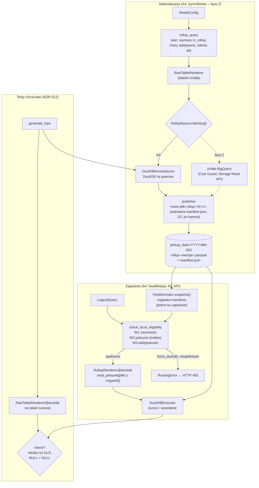

# A4 – Dane syntetyczne, rollupy, DuckDB i testy różnicowe: notatka implementacyjna

## Co zostało zbudowane

- **`tests/fixtures/synthetic.py`** – deterministyczny generator surowych przejazdów (`generate_trips(days, rows_per_day, start, seed, empty_day_offsets, money_as_decimal)` → `pyarrow.Table`) o kolumnach tabeli BigQuery `tlc_yellow_trips_2022`. Znaczniki czasu z dokładnością do pełnych sekund, typ `timestamp[us]` bez strefy. Przypadki brzegowe obecne deterministycznie w każdym dniu z danymi: grupa `payment_type = 3` z zerową sumą `fare_amount`, grupa `payment_type = 4` z zerowym czasem i dystansem (plus pojedyncze przejazdy o zerowym czasie w innych grupach), przejazd przez północ, wartości `NULL` w sześciu kolumnach miar i w wymiarze `rate_code`, dzień bez żadnych przejazdów (domyślnie 4. dzień zakresu). Wariant `money_as_decimal=True` zamienia kwoty i dystans na `decimal128(38, 9)` (odpowiednik `NUMERIC`).
- **`app/sync/rollup_query.py`** – generator zapytania rollupu. Buduje zwykły plan logiczny `LogicalQuery` (wymiary `in_rollup: true`, addytywne miary bazowe jako metryki `MeasureRef`, filtr `partition_key ∈ [start, end]`, sortowanie po wymiarach) i renderuje go **istniejącym** `RawTableRenderer` – generator nie ma ani jednej linii własnej logiki SQL. API: `rollup_dimensions`, `rollup_measures`, `build_rollup_plan(config, date_range)`, `render_rollup_query(config, source_table, date_range, dialect)`.
- **`app/sync/atomic_writer.py`** – `atomic_write` (dowolny plik przez `.tmp` → `fsync` → `os.replace`, sprzątanie `.tmp` po błędzie), `write_partition` (**nowy, niezmienny** plik `pickup_date=D/rollup-<wersja>.parquet`, snappy, bez kolumny partycji; istniejący plik → `FileExistsError`), `split_by_partition`, `fsync_dir`, `WrittenPartition`.
- **`app/sync/manifest.py`** – `manifest.json`: `Manifest` (wersja, klucz partycji, czas publikacji, schemat rollupu, mapa dzień → `PartitionEntry`, lista `RetiredFile` z czasem wycofania), walidujący odczyt (`ManifestError`), atomowy zapis.
- **`app/sync/publisher.py`** – `publish_partitions` (blokada `flock`, zapis nowych plików w wersji N+1, wyznaczenie nowego stanu, atomowa podmiana manifestu, GC) i `collect_garbage` (samodzielne sprzątanie); `DEFAULT_RETENTION = 1 h`.
- **`app/sync/materializer.py`** – protokół `RollupSource` (`dialect`, `source_table`, `fetch(sql) -> pa.Table`) oraz `materialize_rollups(config, source, date_range, base_path, retention, clock)`: zapytanie → wynik → publikacja. Wspólny krok dla lokalnego budowania i przyszłego SyncWorkera.
- **`app/sync/local_builder.py`** – `DuckDBArrowSource` (krótkotrwałe połączenie DuckDB z zarejestrowaną tabelą `pyarrow`) i `build_local_rollups(raw, config, date_range, base_path)`.
- **`app/sync/partition_index.py`** – `PartitionSnapshot` (niemutowalna migawka jednej wersji manifestu: `files_for(date_range)`, `missing_days`, `count_missing`) i `PartitionIndex(base_path, partition_key, check_interval=0)` (`snapshot()`, `refresh()`, `current`, `for_cache`).
- **`app/executors/base.py`** – `QueryExecutor` (ABC), `ExecutionResult` (tabela `pyarrow`, `execution_time_ns`/`_ms`, `to_rows()`), `QueryExecutionError`. **`app/executors/duckdb_executor.py`** – `DuckDBExecutor`: jedno połączenie `:memory:`, kursor na każde wywołanie, pomiar `perf_counter_ns`.
- **`app/router/decision_engine.py`** – `check_local_eligibility(plan, model, snapshot) -> LocalEligibility` (ocena Warunków 1–3 z powodami tekstowymi, brakującymi dniami, `raise_if_ineligible()` / `to_error()` dla trybu `force_duckdb`). **`app/router/exceptions.py`** – `RoutingError` i trzy wyjątki z `details` pod odpowiedź JSON.
- **`app/renderers/rollup.py`** (zmiana A3) – `RollupRenderer(files)` przyjmuje jawną listę plików z migawki (`read_parquet([...])`); usunięto `rollup_glob`/`rollup_glob_for` i stałą `ROLLUP_FILE_NAME`.
- **Testy:** `tests/test_differential.py` (1058), `tests/test_synthetic.py` (19), `tests/sync/` (75), `tests/executors/` (9), `tests/router/` (20); wspólne fixture'y danych syntetycznych, rollupów i migawki w `tests/conftest.py`, pomocnicza publikacja w `tests/sync/helpers.py`.
- **Zmiana ADR-005 (decyzja autora po analizie problemu z DuckDB):** niezmienne pliki wersjonowane + `manifest.json` + migawki indeksu + jawna lista plików + GC po okresie karencji. Zaktualizowano dok. 01 (ADR-003, ADR-005), dok. 03 (układ katalogów, Moduły 2, 4, 5, `compiled_sql`) i komentarz w `configs/nyc_taxi.yaml`.
- **Poprawka w A2/A3 (wykryta testami różnicowymi):** pole `AggregationSpec.empty_input_value` (dla `COUNT` = 0) i `COALESCE(SUM(trips_count), 0)` w `RollupRenderer` – szczegóły w „Napotkanych problemach”. Zaktualizowano 3 pliki golden SQL, 2 testy rendererów, dok. 03 (Moduł 1 pkt 6, `compiled_sql` w sekcji 4, układ katalogów).

## Metodyka testów różnicowych

**Idea (ADR-012):** ta sama metryka liczona dwiema niezależnymi ścieżkami musi dać ten sam wynik.

1. **Dane.** `generate_trips(days=12, rows_per_day=250)` – 2750 przejazdów z 11 dni (2022-12-01…12, bez 2022-12-04).
2. **Rollupy.** `build_local_rollups` – zapytanie z `rollup_query` (to samo, którego użyje SyncWorker) wykonane w DuckDB na tabeli surowej, wynik podzielony po `pickup_date` i opublikowany (wersja 1 manifestu) w katalogu tymczasowym: 11 plików, 249 wierszy.
3. **Macierz przypadków** – iloczyn kartezjański:
   - **13 metryk addytywnych** z `nyc_taxi.yaml` (7 miar bazowych + 6 metryk pochodnych; pobierane z modelu semantycznego, test pilnuje, że lista jest pełna i nie zawiera `unique_pickup_zones`),
   - **8 zestawów wymiarów** rollupowych: pusty, `pickup_date`, `vendor_id`, `payment_type`, `rate_code`, `pickup_date+vendor_id`, `vendor_id+payment_type+rate_code`, wszystkie cztery,
   - **10 scenariuszy filtrów:** pełny zakres, jeden dzień (z przejazdem przez północ), zakres przez dziurę, wyłącznie dzień-dziura (pusty wynik), zakres otwarty (`>`), brak filtrów, `payment_type == '1'`, `payment_type in ['3']` (zerowa suma opłat), `payment_type == '4'` (zerowy czas), `!=` + `not_in` (z `NULL` w `rate_code`).
4. **Porównanie.** Każde żądanie przechodzi przez builder planu (`plan_query`) i jest renderowane dwukrotnie: `RawTableRenderer@duckdb` na tabeli `raw_trips` (zarejestrowanej z `pyarrow`) oraz `RollupRenderer@duckdb` na plikach z migawki indeksu dla zakresu planu (`read_parquet([...], hive_partitioning = true)`, jak w routerze; gdy zakres nie ma żadnego pliku – wszystkie pliki) przez `DuckDBExecutor`. Wyniki są mapowane `krotka wymiarów → wartość`; wymagany jest identyczny zbiór grup i wartości równe z tolerancją `math.isclose(rel_tol=1e-9, abs_tol=1e-9)`; `NULL` jest równy wyłącznie `NULL`. Dla scenariuszy niepustych test sprawdza też, że wynik nie jest pusty (porównanie nie jest trywialne).
5. **Testy pomocnicze:** wszystkie 13 metryk w jednym zapytaniu (wspólne liście w drzewie SQL); przypadki brzegowe rzeczywiście osiągnięte (`NULL` w `tip_to_fare_ratio_pct` dla grupy z zerowymi opłatami, `NULL` w `avg_trip_speed_mph` dla zerowego czasu, grupa `rate_code = NULL`, pusty wynik bez wymiarów); dowód, że tolerancja jest potrzebna (co najmniej jedna grupa różni się bitowo); wariant `NUMERIC` (13 metryk × 3 zestawy wymiarów × 3 scenariusze, sumy dokładne – wartości identyczne).

Scenariusze celowo obejmują zapytania, których router nie skierowałby do cache (zakres z dziurą, otwarty) – test weryfikuje semantykę obu renderów, a nie decyzję routera.

**Liczba porównań:** 1040 przypadków macierzy (13 × 8 × 10), w których porównano łącznie **17 758 wartości** (grup wynikowych), w tym **796 wartości `NULL`**; dodatkowo 9 przypadków wariantu `NUMERIC` (po 13 metryk) i 1 zapytanie z 13 metrykami naraz. Wszystkie zgodne. Czas całego pliku: ok. 10 s.

**Uzasadnienie tolerancji.** Suma zmiennoprzecinkowa zależy od kolejności dodawania: ścieżka surowa sumuje wiersze przejazdów, ścieżka rollupowa – sumy dzienne. Przykład z danych: `total_revenue` dla (2022-12-01, vendor 2) = `5921.35` (rollup) vs `5921.349999999999` (surowa). `abs_tol` obejmuje różnice wokół zera (np. `non_fare_surcharges` = różnica sum). Dla `NUMERIC` wyniki są bitowo identyczne.

## Kontrprzykład: średnia z dziennych wskaźników

Test `test_counterexample_mean_of_daily_ratios_is_wrong` – `tip_to_fare_ratio_pct` dla pełnego zakresu 2022-12-01…12 (11 dni z danymi):

| Wielkość | Wartość |
|---|---|
| wartość poprawna, ścieżka surowa: `SUM(tip) / SUM(fare) * 100` na całym zakresie | **11,728159** % |
| wartość poprawna, ścieżka rollupowa: `SUM(total_tip_amount) / SUM(total_fare_amount) * 100` | **11,728159** % (różnica 2,5·10⁻¹⁴) |
| **naiwna średnia arytmetyczna 11 dziennych wartości wskaźnika** | **12,495063** % |
| średnia dziennych wartości ważona dzienną sumą `fare_amount` | 11,728159 % |
| rozrzut wartości dziennych | 7,29 % – 19,66 % |

Błąd naiwnej średniej: **+0,767 p.p.**, tj. **+6,5 %** wartości poprawnej. Źródło: dni z niską sumą opłat mają wysoki wskaźnik napiwków (np. 2022-12-03: suma opłat 7675,49, wskaźnik 19,66 %; 2022-12-07: 11 686,49 i 7,29 %), a średnia arytmetyczna przypisuje każdemu dniu tę samą wagę. Średnia ważona mianownikiem odtwarza wynik poprawny – co jest algebraicznym uzasadnieniem „złotej zasady” (dok. 02): rollup przechowuje licznik i mianownik osobno, a dzielenie wykonuje się dopiero po zsumowaniu zakresu. Generator celowo losuje mnożnik opłat i stopę napiwków per dzień z ujemną korelacją, aby efekt był wyraźny; przy danych rzeczywistych jego wielkość zależy od zmienności dziennych wolumenów.

## Rozmiar rollupu vs dane surowe (dane syntetyczne)

Pomiar skryptem pomocniczym (rollup z czterema wymiarami `in_rollup`, 7 miar addytywnych; surowe dane zapisane jednym plikiem Parquet/snappy):

| Dane surowe | Parquet surowy | Wiersze rollupu | Pliki | Rollup (suma plików) | Redukcja wierszy | Redukcja bajtów |
|---|---|---|---|---|---|---|
| 11 dni × 250 = 2 750 | 107 KB | 249 | 11 | 44 KB | 11× | 2,4× |
| 30 dni × 10 000 = 300 000 | 7,6 MB | 960 | 30 | 134 KB | 312× | 56× |
| 30 dni × 100 000 = 3 000 000 | 69,1 MB | 960 | 30 | 136 KB | 3 125× | 508× |

(W wariantach 2–3 generator wywołano z 31 dniami i domyślną dziurą – 30 dni z danymi.) Rozmiar rollupu nie zależy od liczby przejazdów, tylko od liczby kombinacji wymiarów na dzień: 2 vendorów × 4 typy płatności × 4 wartości `rate_code` (z `NULL`) = **32 wiersze/dzień**. Przy tak małych plikach dominuje stały narzut metadanych Parquet (ok. 4,4 KB na plik) – dla danych rzeczywistych proporcja będzie zależała od faktycznej kardynalności wymiarów (do zmierzenia w fazie 2). Budowa rollupu 3 mln wierszy w DuckDB: ok. 0,08 s (generowanie danych w czystym Pythonie: ok. 52 s – generator nie jest narzędziem wydajnościowym).

## Decyzje nieopisane wprost w specyfikacji (decyzja, rozważone alternatywy, uzasadnienie)

1. **Zapytanie rollupu jako plan logiczny.** `build_rollup_plan` konstruuje `LogicalQuery`, a SQL powstaje w `RawTableRenderer`. *Alternatywa:* osobny builder `exp.Select` korzystający z `RawTableRenderer.dimension_expr`/`measure_expr`. *Uzasadnienie:* zero duplikacji (szkielet `SELECT/WHERE/GROUP BY/ORDER BY`, literały dat, transpilacja dialektu), a test `test_same_plan_as_raw_table_renderer` formalnie to utrwala. Konsekwencja istotna dla testów różnicowych: rollup i ścieżka surowa liczą liście **tym samym kodem**, więc ewentualna różnica wyników może pochodzić wyłącznie z re-agregacji (`RollupRenderer`) – dokładnie z tego, co ma być weryfikowane.
2. **`ORDER BY` po wszystkich wymiarach w zapytaniu rollupu** – deterministyczna zawartość plików (powtórna synchronizacja daje identyczny plik, test `test_partial_range_and_rebuild`) i lepsze statystyki min/max grup wierszy. Koszt pomijalny (wynik ma setki–tysiące wierszy).
3. **Typy źródłowe generatora.** Identyfikatory kategorii jako `INT64` (rzutowanie `CAST(... AS STRING)` z YAML jest wtedy nietrywialne i sprawdza transpilację), kwoty domyślnie jako `FLOAT64` (wariant trudniejszy – niełączność dodawania), z opcją `NUMERIC`. Faktyczne typy tabeli publicznej są do potwierdzenia w fazie 2.
4. **Normalizacja `HUGEINT` → `INT64` w źródle lokalnym.** `SUM(BIGINT)` w DuckDB ma typ `HUGEINT`, eksportowany do Arrow jako `decimal128(38, 0)`; w BigQuery `SUM(INT64)` to `INT64`. `DuckDBArrowSource` rzutuje kolumny `decimal(p, 0)` na `int64` (rzutowanie bezpieczne – przepełnienie zgłasza błąd), żeby rollup lokalny miał te same typy co rollup z BigQuery. Normalizacja jest cechą źródła, nie zapisu.
5. **Dzień bez danych nie dostaje partycji.** Publikacja zapisuje tylko dni obecne w wyniku, a dni z zakresu publikacji nieobecne w wyniku **usuwa z manifestu** (źródło nie ma już dla nich danych). Router traktuje taki dzień jako brakujący (bezpieczny fallback). *Alternatywa:* znacznik „zsynchronizowano, 0 wierszy” – odłożona (patrz „Otwarte kwestie”).
6. **`fsync` pliku `.tmp` przed `os.replace`** – chroni przed sytuacją, w której po awarii zasilania nowa nazwa wskazuje na niezapisane bloki. Po podmianie manifestu wykonywany jest też `fsync` katalogu (trwałość samej publikacji); dla plików Parquet nie jest potrzebny – plik niewskazany przez manifest jest niewidoczny.
7. **Kontrola kolumny partycji w `write_partition`.** Jeśli tabela dnia zawiera `partition_key`, wszystkie wartości muszą być równe dniowi z nazwy katalogu – inaczej `ValueError` (wiersz z innego dnia w złym katalogu dałby cichy błąd wyników).
8. **Indeks partycji jako niemutowalna migawka manifestu.** `PartitionSnapshot` jest zamrożony; `refresh()` buduje nową migawkę i podmienia referencję jednym przypisaniem (odświeżenia serializuje blokada, czytelnicy jej nie potrzebują). Zapytanie, które pobrało migawkę, używa jej do końca – późniejsza publikacja jej nie zmienia (test `test_snapshot_is_stable_while_new_versions_are_published`). Źródłem prawdy jest wyłącznie manifest: pliki spoza niego (osierocone, `.tmp`, ręcznie wgrane) nie są partycjami, a dzień, którego plik zniknął z dysku, jest pomijany z ostrzeżeniem w logu (trafi do BigQuery). Brak manifestu = pusty indeks (wersja 0). Uszkodzony manifest → `ManifestError`, poprzednia migawka pozostaje aktywna.
9. **Ograniczenie kosztu Warunku 2.** `count_missing` liczy braki bez iteracji po zakresie (liczba dni zakresu − dni indeksu w zakresie), a `missing_days(limit=100)` kończy pętlę po 100 brakach. Zapytanie z zakresem `0001-01-01…9999-12-31` (poprawne dla buildera) nie generuje więc listy 3,6 mln dat (test `test_condition_2_huge_range_is_cheap`). Komunikat pokazuje 10 dni i „and N more”, `details` – do 100 dni i pełną liczbę.
10. **`check_local_eligibility` ocenia wszystkie trzy warunki** (bez skracania) – pełna diagnostyka do telemetrii; `reason` i `raise_if_ineligible()` zwracają pierwszy niespełniony warunek w kolejności 1, 2, 3 (zgodnie z dok. 03, Moduł 2). Funkcja przyjmuje `SemanticModel` i sprawdza zgodność nazwy modelu i klucza partycji (planu, modelu, indeksu) – niezgodność to błąd programistyczny (`ValueError`). Powody są po angielsku (trafią do API), w formacie ze specyfikacji: `Dimension 'dropoff_location_id' not present in local rollup`.
11. **Wyjątki routingu mają `details`** (słownik pod JSON odpowiedzi A5: wymiary, brakujące dni, zakres, miary) i `error_type` = nazwa klasy – spójnie z `QueryValidationError` z A3.
12. **`DuckDBExecutor`: blokada tylko na tworzenie kursora.** Obiekt połączenia DuckDB nie jest bezpieczny wątkowo, kursor (osobne połączenie do tej samej bazy) – tak. Blokada obejmuje wyłącznie `connection.cursor()`, zapytania wykonują się równolegle. Pomiar czasu obejmuje wykonanie i pobranie pełnego wyniku do Arrow (`cursor.sql(sql).to_arrow_table()` – w DuckDB 2.0 `fetch_arrow_table` nie istnieje, a `execute(...).to_arrow_table()` wykonuje dodatkową kopię). Błędy silnika opakowuje `QueryExecutionError` (SQL + przyczyna).
14. **Odświeżanie indeksu: `check_interval` z domyślną wartością `0`.** Autor rozważał odświeżanie przy każdym zapytaniu lub co X sekund, z warunkiem, że indeks nie zmieni się w trakcie zapytania. Warunek zapewnia migawka (decyzja 8), niezależnie od trybu. Obie strategie realizuje jeden parametr: `snapshot()` sprawdza manifest co najwyżej raz na `check_interval` sekund. Domyślne `0` (sprawdzenie przy każdym zapytaniu) jest tanie: sprawdzenie to jedno `stat` manifestu, a plik jest wczytywany ponownie tylko wtedy, gdy zmieni się `(st_ino, st_mtime_ns, st_size)` – `os.replace` zawsze daje nowy i-węzeł. Wartość > 0 ogranicza nawet `stat` (np. przy wolnym systemie plików sieciowych) kosztem opóźnienia widoczności nowych danych. SyncWorker (osobny proces) nie musi powiadamiać aplikacji.
15. **Okres karencji GC (`retention`, domyślnie 1 h)** musi przekraczać czas życia migawki: maksymalny czas zapytania + `check_interval`. Zapytania DuckDB na rollupach trwają milisekundy, więc 1 h to zapas o kilka rzędów wielkości; koszt to chwilowo dwie wersje plików odświeżanych dni na dysku. Wycofany plik ma w manifeście czas wycofania (nie czas utworzenia – stary plik wycofany przed chwilą ma dawne `mtime` i nie może być usunięty natychmiast). Pliki osierocone (zapisane, lecz nieopublikowane, np. po awarii) są usuwane po `retention` od `mtime`. GC wykonuje się przy każdej publikacji oraz osobno (`collect_garbage`); puste katalogi dni są usuwane.
16. **Zmiana schematu rollupu unieważnia dni spoza zakresu publikacji.** Manifest przechowuje schemat Arrow plików. Jeśli nowa publikacja ma inny schemat (np. nowa miara w YAML), dni spoza jej zakresu są usuwane z manifestu – jedno zapytanie nie może łączyć plików o różnych schematach (`union_by_name` dałoby `NULL` w nowych kolumnach starych dni, czyli cicho błędne sumy). Zapytania o unieważnione dni trafią do BigQuery do czasu ich ponownej synchronizacji (`PublicationResult.invalidated_days`, ostrzeżenie w logu). *Alternatywa:* odrzucenie publikacji niepokrywającej wszystkich dni – bezpieczne, ale blokuje stopniową przebudowę.
17. **Jeden pisarz naraz – blokada `flock`** na `{base_path}/.publish.lock` (odczyt–modyfikacja–zapis manifestu przez dwóch pisarzy gubiłby zmiany; test: 16 równoległych publikacji → wersje 1…16). `fcntl` jest dostępny w POSIX (system docelowy: Linux/Docker).
18. **mypy:** tryb ścisły rozszerzony na `app.sync`, `app.executors`, `app.router`; `pyarrow` nie publikuje adnotacji typów, więc dodano `ignore_missing_imports` dla `pyarrow.*` (*alternatywa:* zależność deweloperska `pyarrow-stubs` – odłożona, by nie dodawać pakietów bez potrzeby).

## Napotkane problemy i sposób rozwiązania

- **Błąd semantyczny wykryty testami różnicowymi: `COUNT` na pustym wejściu.** Zapytanie **bez wymiarów**, którego filtry nie pasują do żadnego wiersza (scenariusz `gap_day_only`), zwraca jeden wiersz. Ścieżka surowa: `COUNT(1)` = **0**. Ścieżka rollupowa: re-agregacja `COUNT → SUM` daje `SUM(trips_count)` po pustym zbiorze = **`NULL`**. Przypadek `trips_count-none-gap_day_only` nie przechodził. Problem nie występuje przy `GROUP BY` (grupa istnieje tylko, gdy ma wiersze, a każdy wiersz rollupu ma `trips_count ≥ 1`) ani dla `SUM`/`MIN`/`MAX` (puste wejście → `NULL` w obu ścieżkach). Rozwiązanie: nowe pole rejestru `AggregationSpec.empty_input_value` („wynik agregacji na pustym wejściu, gdy różni się od wyniku re-agregacji”), `COUNT` → `0`; `RollupRenderer` opakowuje wtedy re-agregację w `COALESCE(SUM(trips_count), 0)`. *Alternatywa:* `COALESCE` tylko dla zapytań bez wymiarów – mniej zmian w plikach golden, ale warunek trudniejszy do uzasadnienia; wybrano regułę bezwarunkową (przy `GROUP BY` jest neutralna). Zmieniono `compiled_sql` w dok. 03 oraz 3 pliki golden. Po wycofaniu poprawki test różnicowy ponownie zawodzi dokładnie w tym przypadku (sprawdzone). To dobry przykład do pracy: test różnicowy znalazł błąd, którego nie wykryły testy golden SQL – zapytanie było „poprawne składniowo”, a różniło się semantyką na brzegu dziedziny.
- **Atomowa podmiana a DuckDB – rozbieżność z uzasadnieniem ADR-005 (do decyzji autora).** Test „czytelnik w wątku podczas wielokrotnych podmian” w pierwszej wersji czytał plik przez `pq.read_table(ścieżka)` i zgłaszał błędy (`Invalid column metadata`, `Page was smaller than expected`). Eksperyment (400 podmian pliku 1 000 / 20 000 wierszy w pętli, równoległy czytelnik):

  | Czytelnik | Odczyty | Błędy |
  |---|---|---|
  | `open()` + `pq.read_table(uchwyt)` (jeden deskryptor) | 611 | **0** |
  | `pq.read_table(ścieżka)` | 582 | 94 |
  | DuckDB `read_parquet(ścieżka)` | 362–395 | 72–92 (`Prefetch registered for bytes outside file`, `Out of buffer`) |

  Wniosek: `os.replace` działa zgodnie z oczekiwaniami – plik pod ścieżką jest zawsze kompletny, a czytelnik z otwartym deskryptorem dokańcza starą wersję (i-węzeł). Jednak **DuckDB otwiera plik po ścieżce więcej niż raz w obrębie jednego zapytania** (metadane w fazie wiązania, dane w fazie skanowania); podmiana pomiędzy nimi daje metadane wersji N i dane wersji N+1 → błąd zapytania. Ustawienia `enable_external_file_cache=false`, `parquet_metadata_cache=false`, `disable_parquet_prefetching=true`, `prefetch_all_parquet_files=false` nie usuwają problemu. W dodatkowym eksperymencie z dwiema wersjami o identycznym układzie (100 000 wierszy, 10 grup wierszy, filtr wymuszający pomijanie grup po statystykach; 1 279 odczytów) zaobserwowano wyłącznie poprawne wyniki jednej z wersji albo błąd – **nie zaobserwowano cichego wymieszania wersji** (co nie jest dowodem, że jest ono niemożliwe). Zdanie z pierwotnego ADR-005 „otwarte deskryptory plików w DuckDB dokończą czytanie starej wersji pliku” było więc prawdziwe dla pojedynczego deskryptora, ale nie dla zapytania DuckDB jako całości. Problem dotyczył wyłącznie **podmiany istniejącej partycji w trakcie trwającego zapytania**, a ponowna synchronizacja wstecz (korekty danych, przebudowa po zmianie YAML) jest w projekcie potrzebna – stąd odrzucenie wariantu „bez nadpisywania” i wybór migawek.

  **Rozwiązanie (po decyzji autora):** wariant (b) – niezmienne pliki wersjonowane i manifest (decyzje 8, 14–17, ADR-005). Test `test_duckdb_reader_never_fails_during_republications`: dwa wątki wykonują w pętli zapytania DuckDB na liście plików z migawki, a w tym czasie ten sam dzień jest publikowany 150 razy naprzemiennie w wersji 1 000 i 20 000 wierszy (scenariusz, który przy nadpisywaniu dawał ok. 20% błędów) – **zero błędów**, każdy wynik odpowiada dokładnie jednej wersji; test powtórzony 5 razy.
- **DuckDB 2.0 – zmiany API:** brak `fetch_arrow_table()` (jest `to_arrow_table()`); `connection.sql(...)` zwraca relację także dla instrukcji DDL (z kolumną `Count`), więc wstępnie dodana gałąź „instrukcja nie zwraca wierszy” była martwa i została usunięta.
- **Konwersja `float` → `decimal128` w pyarrow** wymaga jawnego `pa.array(wartości, typ)` przy `set_column`; wartości są przeliczane przez `Decimal(repr(x))` (dokładny zapis dziesiętny dwóch miejsc po przecinku zamiast binarnej reprezentacji `float`).
- **Niezależność dni w generatorze.** Parametry dnia losowane są z generatora głównego zawsze (także dla dnia pustego), a przejazdy – z generatora per dzień (`Random(f"{seed}:{offset}")`), więc dodanie dziury nie zmienia danych pozostałych dni (test `test_empty_day_does_not_change_other_days`).

## Fragmenty kodu warte pokazania w pracy (ścieżka, ≤30 linii, dlaczego są istotne)

`app/sync/rollup_query.py` – zapytanie rollupu to zwykły plan logiczny; SQL powstaje w tym samym rendererze co zapytania użytkownika (brak drugiej implementacji = brak rozbieżności):

```python
def build_rollup_plan(config: ModelConfig, date_range: DateRange) -> LogicalQuery:
    start, end = date_range
    measures = rollup_measures(config)          # tylko addytywne (ADR-011)
    dimensions = rollup_dimensions(config)      # tylko in_rollup: true
    partition = next(d for d in dimensions if d.name == config.storage.local_cache.partition_key)
    return LogicalQuery(
        model_name=config.model_name,
        partition_key=partition.name,
        dimensions=dimensions,
        metrics=tuple(PlannedMetric(n, MeasureRef(n), frozenset({n}), additive=True) for n in measures),
        filters=(PlannedFilter(partition, ">=", (start,)), PlannedFilter(partition, "<=", (end,))),
        order_by=tuple(PlannedOrder(d.name, "ASC") for d in dimensions),
        limit=None,
        date_range=(start, end),
        base_measures=MappingProxyType(measures),
        used_dimensions=MappingProxyType({d.name: d for d in dimensions}),
    )

def render_rollup_query(config, source_table, date_range, dialect, *, pretty=False) -> str:
    return RawTableRenderer(source_table).render(build_rollup_plan(config, date_range), dialect, pretty=pretty)
```

`app/sync/publisher.py` – publikacja (ADR-005): nowe pliki, potem atomowa podmiana manifestu, potem GC (skrót):

```python
with _publication_lock(base):                                   # jeden pisarz naraz
    current = read_manifest(base, partition_key) or Manifest.empty(partition_key)
    version = current.version + 1
    written = tuple(write_partition(t, base, partition_key, day, version)  # NOWE pliki
                    for day, t in split_by_partition(table, partition_key))
    partitions, retired = dict(current.partitions), list(current.retired)
    # ... zmiana schematu -> wycofaj dni spoza zakresu; dni bez danych -> wycofaj
    for w in written:
        if w.day in partitions:
            retired.append(RetiredFile(partitions[w.day].file, now))  # stara wersja czeka
        partitions[w.day] = PartitionEntry(w.path.relative_to(base).as_posix(), w.rows, w.size_bytes)
    expired, kept = _split_expired(retired, now - retention)
    write_manifest(base, Manifest(version, partition_key, now, fingerprint,
                                  MappingProxyType(partitions), tuple(kept)))  # MOMENT PUBLIKACJI
    collected = _delete(base, expired) + _collect_orphans(base, manifest, now - retention)
```

Użycie po stronie zapytania – jedna migawka na decyzję i pliki:

```python
snapshot = partition_index.snapshot()             # stat manifestu; wczytanie tylko po zmianie
eligibility = check_local_eligibility(plan, model, snapshot)
if eligibility.eligible:
    sql = RollupRenderer(snapshot.files_for(plan.date_range)).render(plan, "duckdb")
```

`app/renderers/rollup.py` – poprawka wykryta testem różnicowym (pusty zbiór wejściowy):

```python
reaggregated = aggregate(spec.rollup_reaggregate, exp.column(name))   # SUM(trips_count)
if spec.empty_input_value is None:
    return reaggregated
# COUNT na pustym wejściu daje 0, a SUM(liczności) z pustego rollupu – NULL.
return exp.Coalesce(this=reaggregated, expressions=[exp.Literal.number(spec.empty_input_value)])
```

`tests/test_differential.py` – sedno porównania (identyczny zbiór grup, wartości z tolerancją, `NULL` = `NULL`):

```python
def values_equal(raw: Any, rollup: Any) -> bool:
    if raw is None or rollup is None:
        return raw is None and rollup is None
    return math.isclose(_number(raw), _number(rollup), rel_tol=1e-9, abs_tol=1e-9)

@pytest.mark.parametrize(("metric", "dims", "scenario"), CASES)   # 13 × 8 × 10 = 1040
def test_raw_equals_rollup(runner, metric, dims, scenario):
    dimensions = DIMENSION_SETS[dims]
    plan = runner.plan(dimensions, [metric], SCENARIOS[scenario])
    raw_rows = runner.raw(plan)                    # RawTableRenderer@duckdb, tabela surowa
    if scenario not in EMPTY_SCENARIOS:
        assert raw_rows
    assert_same_result(raw_rows, runner.rollup(plan), dimensions, metric)   # RollupRenderer@duckdb
```

Zapytanie rollupu wygenerowane dla BigQuery (SyncWorker, faza 2):

```sql
SELECT
  DATE(pickup_datetime) AS pickup_date,
  CAST(vendor_id AS STRING) AS vendor_id,
  CAST(payment_type AS STRING) AS payment_type,
  CAST(rate_code AS STRING) AS rate_code,
  COUNT(1) AS trips_count,
  SUM(fare_amount) AS total_fare_amount,
  SUM(tip_amount) AS total_tip_amount,
  SUM(total_amount) AS total_revenue,
  SUM(trip_distance) AS total_distance_miles,
  SUM(passenger_count) AS total_passenger_count,
  SUM(TIMESTAMP_DIFF(dropoff_datetime, pickup_datetime, SECOND)) AS total_duration_seconds
FROM bigquery-public-data.new_york_taxi_trips.tlc_yellow_trips_2022
WHERE
  DATE(pickup_datetime) >= CAST('2022-12-01' AS DATE)
  AND DATE(pickup_datetime) <= CAST('2022-12-31' AS DATE)
GROUP BY pickup_date, vendor_id, payment_type, rate_code
ORDER BY pickup_date ASC NULLS LAST, vendor_id ASC NULLS LAST, payment_type ASC NULLS LAST, rate_code ASC NULLS LAST
```

## Diagram (Mermaid), jeśli pomaga zrozumieć etap



## Liczby (liczba testów, pokrycie, rozmiar modułów)

- Testy: **1567** łącznie (384 z A1–A3 + **1183** nowych): `tests/test_differential.py` 1058 (1040 macierz + 9 `NUMERIC` + 9 pomocniczych), `tests/test_synthetic.py` 19, `tests/sync/` 75 (`test_publisher` 15, `test_partition_index` 18, `test_manifest` 14, `test_local_builder` 10, `test_atomic_writer` 9, `test_rollup_query` 9), `tests/executors/` 9, `tests/router/` 20, renderery +2, rejestr +1. Wszystkie zielone; czas ok. 17 s (ok. 25 s z pomiarem pokrycia).
- Pokrycie (`pytest-cov`, z gałęziami) dla `app/`: **99%** (0 niepokrytych instrukcji; 3 częściowe gałęzie z A2–A3). Nowe moduły A4: 100%.
- Rozmiar (linie): `sync/rollup_query.py` 103, `sync/atomic_writer.py` 141, `sync/manifest.py` 198, `sync/publisher.py` 282, `sync/materializer.py` 108, `sync/local_builder.py` 70, `sync/partition_index.py` 186, `renderers/rollup.py` 73, `executors/base.py` 72, `executors/duckdb_executor.py` 71, `router/decision_engine.py` 196, `router/exceptions.py` 68; `tests/fixtures/synthetic.py` 204; testy A4 ok. 1450.
- `ruff check`, `ruff format --check`, `mypy app tests` (strict także dla `app.sync`, `app.executors`, `app.router`) – bez błędów.
- Wersje: DuckDB 2.0.0, pyarrow 26.0.0, sqlglot 30.27.0.

## Otwarte kwestie / ryzyka dla kolejnych etapów

- **Konfiguracja `retention` i `check_interval`.** Obecnie parametry funkcji (domyślnie 1 h i 0 s). A5 (indeks w aplikacji) i SyncWorker w fazie 2 (flaga CLI) powinny je udostępnić w ustawieniach; warunek poprawności: `retention` > maksymalny czas zapytania + `check_interval`. Rozważyć przeniesienie do sekcji `storage.local_cache` w YAML (zmiana schematu A1).
- **System plików:** rozwiązanie zakłada lokalny system plików POSIX (atomowe `os.replace`, `flock`, i-węzły). Przy współdzielonym wolumenie sieciowym (np. NFS w kontenerach) gwarancje `flock` i sygnatury `stat` trzeba zweryfikować.
- **Dysk:** do końca okresu karencji odświeżane dni mają dwie wersje plików; przy przebudowie całego cache chwilowo podwaja się jego rozmiar (dla rollupów – setki KB, pomijalne).
- **Dzień bez danych w źródle** nigdy nie dostanie partycji, więc zapytania obejmujące go zawsze trafią do BigQuery. Dla danych NYC TLC dni bez przejazdów nie występują, ale ogólnie warto rozważyć znacznik „zsynchronizowano, 0 wierszy” (np. pusty plik Parquet ze schematem) – wymaga to zmiany definicji indeksu partycji.
- **A5:** jeden `PartitionIndex` na model tworzony przy starcie; każde żądanie: `snapshot = index.snapshot()` → `check_local_eligibility(plan, model, snapshot)` → `RollupRenderer(snapshot.files_for(plan.date_range))`. Skrypt seedujący używa `build_local_rollups` (publikacja z manifestem). `/health` może raportować `snapshot.version` i liczbę dni.
- **Przycinanie partycji w BigQuery:** zapytanie rollupu filtruje `DATE(pickup_datetime)`; czy BigQuery przycina partycje tabeli partycjonowanej po `pickup_datetime` przy takim filtrze – do sprawdzenia `dry_run` (bajty) w fazie 2; ewentualnie dodać do planu rollupu filtr na samej kolumnie znacznika czasu.
- **Typy wyniku dla API (A5):** `SUM` liczb całkowitych w DuckDB zwraca `HUGEINT` → w Pythonie `Decimal` (np. `trips_count` w ścieżce rollupowej); serializacja JSON musi obsłużyć `Decimal` i `datetime.date`. Wariant `NUMERIC` kwot daje `Decimal` także w metrykach sum.
- **Rozmiar rollupu dla danych rzeczywistych** zależy od kardynalności `rate_code`/`payment_type`/`vendor_id` w tabeli publicznej – do zmierzenia w fazie 2 (dane syntetyczne: 32 wiersze/dzień, narzut metadanych Parquet dominuje).
- **`DuckDBExecutor` wykonuje dowolny SQL** – bezpieczne, bo SQL pochodzi wyłącznie z `RollupRenderer` (literały AST); nie wolno przekazywać do niego tekstu od klienta API.
