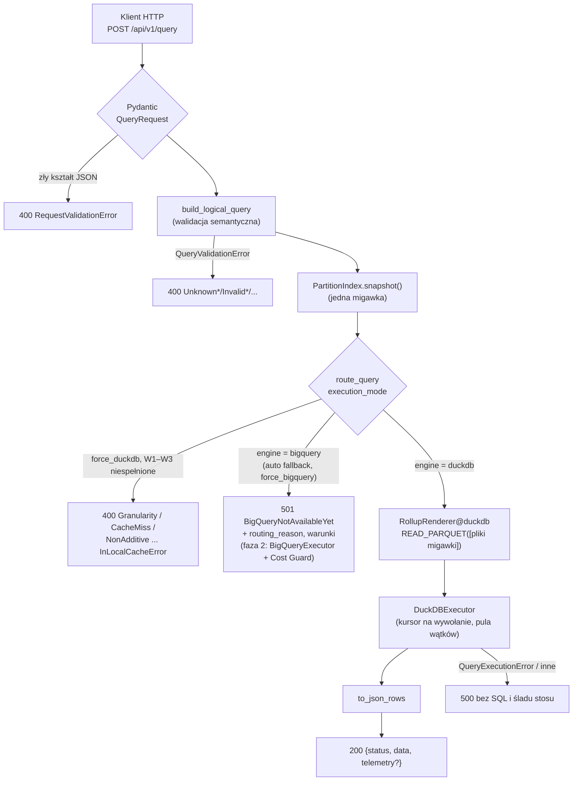

# A5 – Minimalne API (FastAPI): notatka implementacyjna

## Co zostało zbudowane

- **`app/api/models.py`** (rozszerzenie A3) – modele odpowiedzi: `QueryResponse` (`status`, `data`, opcjonalna `telemetry`), `Telemetry` (9 pól z dok. 03, sekcja 4), `ErrorResponse` (`status="error"`, `error_type`, `message`, `details`), `SchemaResponse` / `ModelInfo` / `DimensionInfo` / `BaseMeasureInfo` / `DerivedMetricInfo`, `HealthResponse` / `CacheHealth`, typ `Engine`.
- **`app/api/service.py`** – `QueryService` (niemutowalny stan aplikacji: modele semantyczne, indeksy partycji, wykonawca DuckDB) z metodami `execute`, `schema`, `health`; `to_json_rows` (normalizacja typów Arrow do JSON). Serwis nie zależy od HTTP – w fazie 2 może go wywołać skrypt benchmarków.
- **`app/api/errors.py`** – centralne mapowanie wyjątków na `ErrorResponse` oraz wyjątek `BigQueryNotAvailableYet` (HTTP 501).
- **`app/api/routes.py`** – `POST /api/v1/query`, `GET /api/v1/schema`, `GET /health` (cienkie funkcje `def` nad `QueryService`).
- **`app/main.py`** – `create_app(settings)` (fabryka z `lifespan`), `build_service(settings)`, moduł-poziomowe `app` dla `uvicorn app.main:app`.
- **`app/config/settings.py`** – `Settings` (pydantic-settings, prefiks `HYBRID_ROUTER_`): `config_dir`, `data_root`, `index_check_interval`, `duckdb_threads`; `cache_path(model)`.
- **`app/router/decision_engine.py`** (rozszerzenie A4) – `RoutingDecision` i `route_query(plan, model, mode, snapshot)` (algorytm wyboru silnika z dok. 03, Moduł 2) oraz `LocalEligibility.to_details()`.
- **`scripts/seed_synthetic_cache.py`** – CLI zasiewające `./data/nyc_taxi` rollupami z generatora A4 (domyślnie 2022-12-01…31, 2000 przejazdów/dzień, bez dni pustych).
- **`README.md`** – instalacja, seed, uruchomienie, przykładowy `curl`, testy.
- **Testy:** `tests/api/` – 89 nowych (`test_query` 71, `test_startup` 12, `test_schema_health` 5, `test_end_to_end` 1), `tests/router/` +11 (`route_query`, `to_details`).
- **Zmiany w dok. 03:** układ katalogów (nowe pliki A5, `scripts/`), opis `decision_engine.py`, `compiled_sql` w przykładowej odpowiedzi i ścieżka w Module 4 dostosowane do faktycznego wyniku renderera (`READ_PARQUET([...], hive_partitioning = TRUE)`, ścieżki `data/nyc_taxi/...` bez `./` – normalizacja `pathlib.Path`). W `pyproject.toml` tryb `mypy --strict` rozszerzono na `app.api.*` i `app.main`.

## Decyzje nieopisane wprost w specyfikacji (decyzja, rozważone alternatywy, uzasadnienie)

1. **Endpointy `def` zamiast `async def`.** FastAPI wykonuje funkcje synchroniczne w puli wątków (anyio, domyślnie 40), więc wywołania DuckDB, `stat`/odczyt `manifest.json` i renderowanie `sqlglot` (CPU) nie blokują pętli zdarzeń. *Alternatywa:* `async def` + `run_in_threadpool` wokół wykonawcy – ten sam efekt, ale wymaga pamiętania o każdym wywołaniu blokującym (także o odczycie manifestu i kompilacji, które łatwo przeoczyć); przy `def` cała obsługa żądania jest poza pętlą z definicji. Bezpieczeństwo wątkowe zapewniają: niemutowalny `QueryService` i modele, `PartitionIndex` (podmiana migawki jednym przypisaniem, A4) oraz `DuckDBExecutor` (kursor na wywołanie, A4). Limit współbieżności = rozmiar puli wątków; przy BigQuery (faza 2, wywołania sieciowe trwające sekundy) może wymagać zwiększenia.
2. **Wybór silnika jako czysta funkcja `route_query` w routerze**, a nie w API. Algorytm z dok. 03 (Moduł 2) zwraca `RoutingDecision(engine, mode, reason, eligibility)`; w fazie 1 decyzja `bigquery` jest tylko *wynikiem* – `QueryService` zgłasza wtedy `BigQueryNotAvailableYet`. *Alternatywa:* logika trybów w endpointcie – mieszałaby routing z HTTP i trzeba by ją przenosić w fazie 2. Teraz faza 2 podmienia jedną gałąź w `QueryService.execute`.
3. **Kolejność: walidacja → routing.** Plan logiczny powstaje przed routingiem także w `force_bigquery`, więc błędne zapytanie daje 400 w każdym trybie (test parametryzowany trzema trybami), a nie 501. Zgodne z potokiem ADR-008 (BigQuery też potrzebuje planu do `RawTableRenderer`).
4. **Błędy kształtu żądania (Pydantic) → HTTP 400, nie domyślne 422 FastAPI**, z `error_type = "RequestValidationError"` i listą `{loc, msg, type}` w `details` (bez echa wartości wejściowych). *Uzasadnienie:* spec. mówi o HTTP 400 dla błędów zapytania; dwa różne kody dla „złe pole JSON” i „nieznana metryka” utrudniałyby klientom obsługę. Niepoprawny JSON (`{not json`) – również 400.
5. **Kody i `error_type`.** `error_type` = nazwa klasy wyjątku domenowego (konwencja z A3/A4): `QueryValidationError` i podklasy → 400 (`details.field`), `RoutingError` i podklasy → 400 (`details` z wyjątku: wymiary / zakres + brakujące dni / miary), `BigQueryNotAvailableYet` → 501, `HTTPException` → jej kod z `error_type` z frazy HTTP (`NotFound`, `MethodNotAllowed`), `ConfigValidationError` → 500 (lista problemów – to dane konfiguracji, nie kod), `QueryExecutionError` i `RendererError` → 500 bez SQL i bez przyczyny, każdy inny wyjątek → 500 `InternalServerError`. Ślad stosu i SQL trafiają wyłącznie do logu (`logger.exception`).
6. **`details` odpowiedzi 501** zawiera `engine`, `routing_mode`, `routing_reason` oraz (poza `force_bigquery`) pełną diagnostykę Warunków 1–3 (`LocalEligibility.to_details()`: stan każdego warunku z powodami, brakujące dni, wymiary, miary). Klient (i badacz) widzi, *dlaczego* zapytanie trafiłoby do BigQuery, choć w fazie 1 nie zostanie wykonane.
7. **Telemetria bez narzutu przy `include_telemetry=false`.** Serwis odczytuje zegar (`perf_counter_ns`) tylko przy włączonej telemetrii (test zlicza wywołania zegara: 0 vs 5). Pomiar czasu wykonania wewnątrz `DuckDBExecutor` (A4) pozostaje – to jedno wywołanie zegara w wykonawcy, wspólnym dla wszystkich ścieżek. *Definicje pól:* `ast_compilation_time_ms` = budowa planu (walidacja + rozwinięte AST) + renderowanie SQL – **bez** oceny routingu (stat manifestu, Warunki 1–3); `execution_time_ms` = wykonanie z pobraniem wyniku do Arrow; `total_time_ms` = od zwalidowanego żądania do wierszy JSON (bez parsowania żądania i serializacji odpowiedzi). Czas routingu jest więc zawarty w `total_time_ms`, ale nie w żadnym ze składników – jeśli w badaniach okaże się istotny, warto dodać osobne pole (zmiana kontraktu).
8. **Brak klucza `telemetry` (zamiast `"telemetry": null`)** – `Field(exclude_if=...)` (Pydantic 2.12+); zgodnie z promptem i dok. 02 („zwraca wyłącznie surowe dane”).
9. **Typy JSON wyniku.** `SUM` na kolumnie `int64` rollupu daje w DuckDB `HUGEINT` (Arrow `decimal128(38, 0)`), a Pydantic serializuje `Decimal` jako napis. `to_json_rows` rzutuje `decimal(p, 0)` → `int64` (bezpiecznie), pozostałe `decimal` → `float64`, daty serializuje Pydantic (ISO). Wartości `NULL` (NULLIF) → `null`.
10. **`HYBRID_ROUTER_DATA_ROOT`** zastępuje katalog nadrzędny `base_path`: cache modelu = `{data_root}/{Path(base_path).name}` (dla `./data/nyc_taxi` → `{data_root}/nyc_taxi`). *Alternatywy:* `{data_root}/{model_name}` (zmienia nazwę katalogu względem YAML) lub zmienna per model (niewygodne przy wielu modelach). Dwa modele wskazujące ten sam katalog cache → `ConfigValidationError` przy starcie.
11. **Błąd konfiguracji blokuje start** (`lifespan` zgłasza `ConfigValidationError`, `uvicorn` kończy proces z listą problemów). Katalog bez żadnego `*.yaml` też jest błędem. *Uzasadnienie:* serwis bez modeli lub z częściowo poprawnymi modelami to cichy błąd wdrożenia.
12. **Uszkodzony `manifest.json` w trakcie pracy** – zapytanie używa ostatniej poprawnej migawki (`index.current`, ostrzeżenie w logu), `/health` raportuje `degraded` z opisem błędu. Zgodne z zasadą A4 („poprzednia migawka pozostaje aktywna”). *Alternatywa:* 503 dla wszystkich zapytań – zatrzymałaby serwis przez błąd SyncWorkera, choć pliki poprzedniej wersji są na dysku (GC usuwa je dopiero po `retention`). Ryzyko: jeśli manifest pozostaje uszkodzony dłużej niż `retention`, pliki starej migawki mogą zostać usunięte przez GC – wtedy zapytania zwrócą 500 `QueryExecutionError`; `/health` sygnalizuje problem wcześniej.
13. **`/health`**: per model – `status`, `partitions`, `manifest_version`, `first_day`, `last_day` (oraz `error` przy uszkodzonym manifeście). `/health` wykonuje `index.snapshot()`, więc pokazuje stan po ostatniej publikacji.
14. **`/api/v1/schema`** zwraca dla metryk pochodnych także `base_measures` (miary bazowe po rozwinięciu) – klient widzi, od czego zależy addytywność. Formuła w postaci z YAML (nie rozwinięta).
15. **Skrypt seedujący importuje generator z `tests/fixtures`** (zgodnie z A4 generator jest częścią pakietu testów) i dodaje katalog projektu do `sys.path`, aby działał wywołany jako plik. *Alternatywa:* przeniesienie generatora do `app/` – generator nie jest kodem produkcyjnym. Domyślnie bez dni pustych (żeby przykład z dok. 03 był w pełni pokryty), opcja `--empty-day` pozwala odtworzyć dziurę ręcznie. Ponowne uruchomienie publikuje nową wersję manifestu (stare pliki usuwa GC po okresie karencji).

## Napotkane problemy i sposób rozwiązania

- **Odpowiedź bez klucza `telemetry`.** `response_model_exclude_none` usuwałby także `null` wewnątrz wierszy `data` (np. `tip_to_fare_ratio_pct = null`), a dwa modele odpowiedzi w unii komplikowały OpenAPI. Rozwiązanie: `Field(exclude_if=lambda v: v is None)` tylko na polu `telemetry` (test: `null` w danych zostaje, klucz `telemetry` znika).
- **`removed_days` w skrypcie seedującym.** Pierwsza wersja raportowała dni bez danych z `PublicationResult.removed_days`, które obejmuje tylko dni *usunięte z istniejącego* manifestu – przy pierwszym zasiewie lista była pusta. Skrypt liczy teraz dni zakresu nieobecne w zapisanych partycjach (wykryte testem).
- **Ostrzeżenie Starlette 1.10:** `StarletteDeprecationWarning: Using httpx with starlette.testclient is deprecated; install httpx2`. Testy działają; ostrzeżenie pozostawiono widoczne (nie wyciszano) – patrz „Otwarte kwestie”.
- **Zimny start kompilacji.** Pierwsze żądanie po starcie: `ast_compilation_time_ms` ≈ 23 ms, kolejne ≈ 1,5 ms – parsowanie fragmentów `sql` z YAML (`sqlglot.parse_one`) jest cache'owane w `renderers/base.py` przy pierwszym użyciu. Dla benchmarków istotne: pierwsze zapytanie należy traktować jako rozgrzewkę (lub rozgrzewać cache w `lifespan`).

## Ręczny test: zasiany cache + `curl` z dok. 03, sekcja 4

```text
$ poetry run python scripts/seed_synthetic_cache.py
model nyc_yellow_taxi_analytics: 62000 synthetic trips (2022-12-01..2022-12-31) -> 954 rollup rows in 31 partition(s), 131.4 KiB
published manifest v1: data/nyc_taxi/manifest.json
done in 1.26 s

$ poetry run uvicorn app.main:app --port 8765
$ curl -s localhost:8765/health
{"status":"ok","models":{"nyc_yellow_taxi_analytics":{"status":"ok","partitions":31,"manifest_version":1,"first_day":"2022-12-01","last_day":"2022-12-31"}}}
```

`POST /api/v1/query` z dokładnie przykładowym żądaniem z dok. 03 (`auto`, `include_telemetry: true`) – HTTP 200, 46 wierszy (23 dni × 2 vendorów); poniżej pierwsze trzy wiersze i pełna telemetria (pierwsze żądanie po starcie):

```json
{
  "status": "success",
  "data": [
    {"pickup_date": "2022-12-01", "vendor_id": "1", "trips_count": 561, "total_revenue": 34773.209999999985,
     "tip_to_fare_ratio_pct": 15.636536632447864, "avg_trip_speed_mph": 17.123745472428585},
    {"pickup_date": "2022-12-01", "vendor_id": "2", "trips_count": 649, "total_revenue": 42318.59000000001,
     "tip_to_fare_ratio_pct": 15.607348479037528, "avg_trip_speed_mph": 17.650105985364277},
    {"pickup_date": "2022-12-02", "vendor_id": "1", "trips_count": 529, "total_revenue": 19824.920000000002,
     "tip_to_fare_ratio_pct": 22.573827450247787, "avg_trip_speed_mph": 17.228262002444563}
  ],
  "telemetry": {
    "engine_used": "duckdb",
    "routing_mode": "auto",
    "routing_reason": "All dimensions in rollup and date range [2022-12-01..2022-12-23] available in local Parquet cache.",
    "ast_compilation_time_ms": 23.262,
    "execution_time_ms": 12.001,
    "total_time_ms": 36.357,
    "bytes_scanned": 0,
    "estimated_cost_usd": 0.0,
    "compiled_sql": "SELECT pickup_date, vendor_id, COALESCE(SUM(trips_count), 0) AS trips_count, SUM(total_revenue) AS total_revenue, (SUM(total_tip_amount) / NULLIF(SUM(total_fare_amount), 0)) * 100 AS tip_to_fare_ratio_pct, SUM(total_distance_miles) / NULLIF((SUM(total_duration_seconds) / 3600.0), 0) AS avg_trip_speed_mph FROM READ_PARQUET(['data/nyc_taxi/pickup_date=2022-12-01/rollup-00000001.parquet', 'data/nyc_taxi/pickup_date=2022-12-02/rollup-00000001.parquet', ... (23 pliki) ..., 'data/nyc_taxi/pickup_date=2022-12-23/rollup-00000001.parquet'], hive_partitioning = TRUE) WHERE pickup_date >= CAST('2022-12-01' AS DATE) AND pickup_date <= CAST('2022-12-23' AS DATE) AND payment_type = '1' GROUP BY pickup_date, vendor_id ORDER BY pickup_date ASC LIMIT 1000"
  }
}
```

Kolejne 5 powtórzeń tego samego żądania (ms: kompilacja / wykonanie / całość): 1,55 / 8,26 / 10,27; 1,46 / 7,78 / 9,87; 1,75 / 6,84 / 9,36; 1,47 / 6,53 / 8,42; 1,50 / 6,62 / 8,55. Pomiar orientacyjny na laptopie autora – nie jest benchmarkiem.

Przykłady błędów z tego samego serwera:

```text
# auto + dropoff_location_id -> HTTP 501
{"status":"error","error_type":"BigQueryNotAvailableYet","message":"Query was routed to BigQuery, which is not available in phase 1 (local DuckDB cache only).","details":{"engine":"bigquery","routing_mode":"auto","routing_reason":"Full fallback to BigQuery: Dimension 'dropoff_location_id' not present in local rollup.","conditions":{"granularity":{"satisfied":false,"reasons":["Dimension 'dropoff_location_id' not present in local rollup"]},"time_coverage":{"satisfied":true,"reasons":[]},"additivity":{"satisfied":true,"reasons":[]}},"unsupported_dimensions":["dropoff_location_id"],"date_range":["2022-12-01","2022-12-23"],"missing_days":[],"missing_day_count":0,"non_additive_measures":[]}}

# force_duckdb + unique_pickup_zones -> HTTP 400
{"status":"error","error_type":"NonAdditiveMeasureInLocalCacheError","message":"Measure 'unique_pickup_zones' (COUNT_DISTINCT) cannot be re-aggregated from local rollup (used by metric 'unique_pickup_zones')","details":{"measures":["unique_pickup_zones"]}}

# auto, zakres do 2023-01-02 (poza cache) -> HTTP 501, routing_reason:
"Full fallback to BigQuery: Local cache is missing 2 day(s) of 2022-12-01..2023-01-02: 2023-01-01, 2023-01-02."
```

## Fragmenty kodu warte pokazania w pracy (ścieżka, ≤30 linii, dlaczego są istotne)

`app/router/decision_engine.py` – algorytm wyboru silnika (dok. 03, Moduł 2) jako czysta funkcja; Full Fallback (ADR-004) z powodem do telemetrii:

```python
def route_query(plan, model, mode, snapshot) -> RoutingDecision:
    if mode == "force_bigquery":
        return RoutingDecision("bigquery", mode, "Forced by execution_mode 'force_bigquery'.", None)
    eligibility = check_local_eligibility(plan, model, snapshot)      # Warunki 1–3
    if mode == "force_duckdb":
        eligibility.raise_if_ineligible()                             # -> HTTP 400
        reason = f"Forced by execution_mode 'force_duckdb'; {_local_reason(eligibility)}"
        return RoutingDecision("duckdb", mode, reason, eligibility)
    if eligibility.eligible:
        return RoutingDecision("duckdb", mode, _local_reason(eligibility), eligibility)
    reason = f"Full fallback to BigQuery: {eligibility.reason}."
    return RoutingDecision("bigquery", mode, reason, eligibility)
```

`app/api/service.py` – pełny potok jednego zapytania; jedna migawka indeksu dla decyzji i listy plików; zegar odczytywany tylko przy telemetrii (skrót):

```python
telemetry_on = request.control.include_telemetry
started = clock() if telemetry_on else 0
plan = build_logical_query(request, self.models)                      # 400
planned = clock() if telemetry_on else 0
snapshot = self._snapshot(plan.model_name)                            # jedna migawka
decision = route_query(plan, model, request.control.execution_mode, snapshot)
if decision.engine != LOCAL_DIALECT:
    raise BigQueryNotAvailableYet(decision)                           # 501; faza 2: BigQueryExecutor
routed = clock() if telemetry_on else 0
sql = RollupRenderer(snapshot.files_for(plan.date_range)).render(plan, LOCAL_DIALECT)
rendered = clock() if telemetry_on else 0
result = self.local_executor.execute(sql)
rows = to_json_rows(result.table)
if not telemetry_on:
    return QueryResponse(data=rows)                                   # brak klucza telemetry
```

## Diagram (Mermaid), jeśli pomaga zrozumieć etap



## Liczby (liczba testów, pokrycie, rozmiar modułów)

- Testy: **1667** łącznie (1567 po A4 + **100** nowych): `tests/api/test_query.py` 71 (w tym 36 przypadków walidacji = 12 błędów × 3 tryby), `tests/api/test_startup.py` 12, `tests/api/test_schema_health.py` 5, `tests/api/test_end_to_end.py` 1, `tests/router/` +11. Wszystkie zielone; czas ok. 20 s (ok. 27 s z pokryciem).
- Test end-to-end: 13 metryk addytywnych × wymiary `pickup_date, vendor_id, payment_type`, zakres 2022-12-05…12 z filtrem `not_in` – wszystkie wiersze odpowiedzi API równe wynikowi `RawTableRenderer@duckdb` na danych surowych (tolerancja jak w A4; w porównaniu obecne wartości `null` z NULLIF).
- Pokrycie `app/` (z gałęziami): **99%** – 0 niepokrytych instrukcji; 3 częściowe gałęzie z A2–A3. Nowe moduły A5: 100%.
- Rozmiar (linie): `api/models.py` 178 (w tym 68 z A3), `api/service.py` 192, `api/errors.py` 147, `api/routes.py` 57, `main.py` 104, `config/settings.py` 45, `router/decision_engine.py` 273 (+74), `scripts/seed_synthetic_cache.py` 112; testy A5 ok. 880.
- `ruff check`, `ruff format --check`, `mypy app tests scripts` (strict także dla `app.api.*`, `app.main`) – bez błędów.
- Wersje: FastAPI 0.162.0, Starlette 1.10.0, Pydantic 2.14.2, pydantic-settings 2.16.2.

## Otwarte kwestie / ryzyka dla kolejnych etapów

- **Faza 2 – punkty rozszerzenia pozostawione w fazie 1:**
  1. `QueryService.execute`: gałąź `decision.engine != "duckdb"` (dziś `raise BigQueryNotAvailableYet`) → `BigQueryExecutor` z `RawTableRenderer(config.storage.bigquery.dataset_table).render(plan, "bigquery")`, dry-run i Cost Guard; `bytes_scanned` i `estimated_cost_usd` w `Telemetry` (dziś stałe 0 dla DuckDB).
  2. Cost Guard: wyjątki `CostTooHighForQueryException` (403) i `CostConfirmationRequiredException` (409, `status: "confirmation_required"` – **inny kształt niż `ErrorResponse`**, wymaga osobnego modelu odpowiedzi i handlera w `app/api/errors.py`); obsługa `control.confirm_high_cost` (dziś przyjmowane i ignorowane).
  3. `app/api/routes.py`: endpoint `/api/v1/dry-run` (wymieniony w dok. 03, sekcja 1).
  4. `build_service` (`app/main.py`): utworzenie klienta BigQuery i wykonawcy obok `DuckDBExecutor`; zamknięcie w `lifespan`.
  5. `QueryExecutor` (`app/executors/base.py`): interfejs gotowy na drugą implementację; `ExecutionResult.engine`.
  6. `RollupSource` (`app/sync/materializer.py`): źródło BigQuery dla SyncWorkera (`app/sync/sync_worker.py`, CLI `--config/--start-date/--end-date`) – publikacja i manifest już działają.
  7. `Settings`: parametry fazy 2 (np. projekt GCP, `retention` SyncWorkera); A4 sugerowało rozważenie `retention`/`check_interval` w YAML.
  8. Telemetria: ewentualne osobne pole czasu routingu oraz czasu dry-run BigQuery (zmiana kontraktu dok. 03).
- **Rozgrzewka przed benchmarkami** – pierwsze żądanie po starcie ma ok. 15× dłuższą kompilację (cache parsowania fragmentów `sqlglot`). Można wstępnie skompilować fragmenty w `lifespan`.
- **Pula wątków** (40 domyślnie w anyio) ogranicza współbieżność; przy BigQuery (długie wywołania sieciowe) rozważyć `async` klienta lub większą pulę.
- **`StarletteDeprecationWarning` (httpx → httpx2)** w `TestClient` – przy kolejnej aktualizacji Starlette może być potrzebna zależność deweloperska `httpx2`; decyzja autora (nie dodawano pakietów).
- **`total_time_ms` nie obejmuje serializacji JSON** odpowiedzi (Pydantic + Starlette) – dla dużych wyników może to być istotna część czasu po stronie klienta; benchmarki fazy 2 powinny mierzyć także czas po stronie klienta HTTP.
- **Uszkodzony manifest dłużej niż `retention`** – patrz decyzja 12; `/health` = `degraded` jest sygnałem do monitoringu.
- **Wartości `NaN`/`Inf`** w wynikach nie występują dzięki NULLIF, ale suma `float` mogłaby się przepełnić do `Inf`; Pydantic serializuje je jako `null` (nieodróżnialne od `NULL` SQL). Ryzyko pomijalne dla danych NYC TLC.
