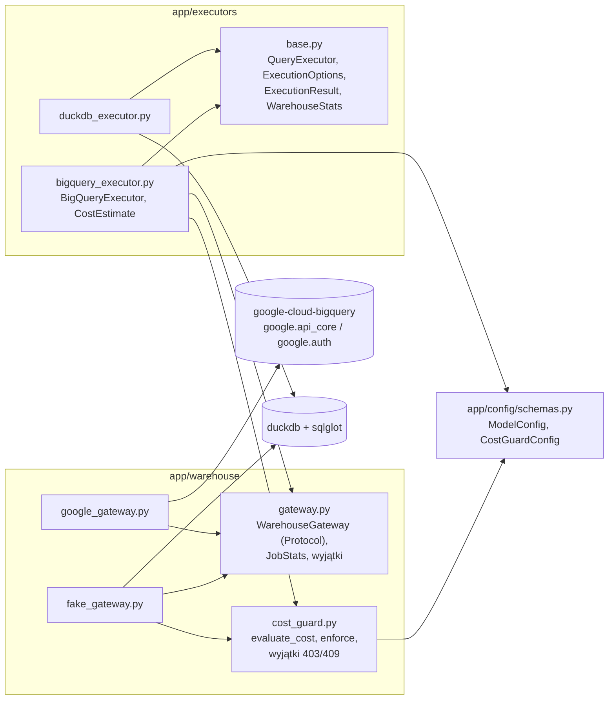

# B1 – Bramka hurtowni, atrapa, strażnik kosztów i wykonawca BigQuery: notatka implementacyjna

## Co zostało zbudowane

- **Konfiguracja.** `BigQueryStorageConfig` (`app/config/schemas.py`) – nowe pola `location` (wymagany niepusty napis) i `job_timeout_s` (liczba > 0, domyślnie 120). `configs/nyc_taxi.yaml`: `location: "US"`, `job_timeout_s: 120`, komentarz, że `dataset_table` jest placeholderem do czasu utworzenia własnej partycjonowanej kopii (F2-3). `Settings` (`app/config/settings.py`): `bigquery_backend: Literal["disabled", "fake", "google"] = "disabled"`, `threadpool_size: int = 40` (> 0; użycie w B2), `fake_raw_path: Path | None`.
- **Pakiet `app/warehouse/`** (ADR-014):
  - `gateway.py` – protokół `WarehouseGateway` (`dry_run`, `run`, `close`), wyniki `DryRunResult` (bajty, czas wywołania), `JobStats` (job_id, bajty przetworzone/rozliczone, cache_hit, znaczniki serwera `created/started/ended`, czas pobrania wyniku po stronie klienta; właściwości `queue_ms`, `server_execution_ms`, `server_total_ms`), `WarehouseRunResult`; wyjątki `WarehouseQueryError` (komunikat hurtowni, `reason`, `status_code`, `job_id`, `sql`), `WarehouseTimeoutError` (`cancelled`), `WarehouseUnavailableError`.
  - `cost_guard.py` – czysta funkcja `evaluate_cost(bytes_processed, config, *, confirmed) -> CostDecision`, funkcje kosztu (`cost_usd`, `estimated_cost_usd`, `actual_cost_usd` z `bytes_billed`), `effective_limit_bytes`, `over_limit_bytes`, `enforce(decision, sql)` oraz wyjątki `CostTooHighForQueryException` / `CostConfirmationRequiredException` (wspólna baza `CostGuardException`, niosą całą decyzję i SQL).
  - `google_gateway.py` – `GoogleBigQueryGateway`, **jedyny moduł `app/` importujący bibliotekę Google** (sprawdzane testem AST).
  - `fake_gateway.py` – `FakeBigQueryGateway` (DuckDB na surowej tabeli `pyarrow` albo pliku/katalogu Parquet), `billed_bytes`, `integer_decimals_to_int64`, historia wywołań `FakeCall`, rejestr anulowanych zadań.
- **Wykonawcy.** `app/executors/base.py`: `ExecutionOptions(confirm_high_cost)`, `WarehouseStats`, pole `ExecutionResult.warehouse` (domyślnie `None`), sygnatura `QueryExecutor.execute(sql, options=None)`. `DuckDBExecutor` przyjmuje i ignoruje opcje (zachowanie bez zmian). Nowy `app/executors/bigquery_executor.py`: `BigQueryExecutor(gateway, config)` z `execute` i `estimate(sql) -> CostEstimate`.
- **`pyproject.toml`** – zależność `google-cloud-bigquery` (3.47), marker `bigquery`, `mypy --strict` także dla `app.warehouse.*` (biblioteki Google mają `py.typed` – `ignore_missing_imports` niepotrzebne; jedno `type: ignore[no-untyped-call]` na `Client.close`). `tests/conftest.py` – hak `pytest_collection_modifyitems` pomijający testy `@pytest.mark.bigquery` bez `HYBRID_ROUTER_BQ_INTEGRATION=1`.
- **Testy:** `tests/warehouse/` (`test_cost_guard` 85, `test_google_gateway` 33, `test_fake_gateway` 33, `test_isolation` 7, w tym jeden celowo pomijany test z markerem), `tests/executors/test_bigquery_executor.py` 22, rozszerzenia `test_duckdb_executor` (+3), `test_config` (+7), `tests/api/test_startup` (+3).
- **Zmiany w specyfikacji:** dok. 03, Moduł 3 – doprecyzowanie pkt 5 (efektywny limit, minimum 10 MB, `enabled: false` bez limitu) i nowa sygnatura interfejsu wykonawców w pkt 8; ADR-006 – zastrzeżenie „przy włączonym strażniku” przy twardym limicie.

## Decyzje nieopisane wprost w specyfikacji (decyzja, rozważone alternatywy, uzasadnienie)

1. **`cost_guard.enabled: false` → brak dry-runu i `maximum_bytes_billed = None`.** *Alternatywa:* zachować twardy limit `max_bytes_per_query` mimo wyłączonego strażnika (bezpiecznik). Odrzucona, bo bez dry-runu nie wiadomo, czy zapytanie mieści się w limicie: „wyłączony” strażnik zamieniałby wtedy czytelne 403/409 na błąd hurtowni 502 (`bytesBilledLimitExceeded`), a `/dry-run` raportowałby `action: allow` dla zapytania, które i tak by się nie wykonało. `enabled: false` jest więc świadomym, całkowitym wyłączeniem ochrony (np. pomiar bez narzutu dry-runu); tryb produkcyjny z pomiarem kosztu to `silent_allow` (ADR-006). Ryzyko budżetowe przy tabeli 2022 (kilka GB) jest małe.
2. **Efektywny limit = `min(max_bytes_per_query, bajty odpowiadające max_cost_usd_per_query)`.** Dok. 03 (pkt 5) mówił „`maximum_bytes_billed` = `max_bytes_per_query`”. Przy cenie lub limicie kosztu, w których to próg kosztu jest niższy, hurtownia nie chroniłaby budżetu kosztowego. Dla `nyc_taxi.yaml` wynik jest identyczny (10 GiB < 0,0625 USD / 6,25 USD·TiB ≈ 10,24 GiB). Dok. 03 zaktualizowany.
3. **Minimum 10 MB (2²⁰ B) dla `maximum_bytes_billed`** – zarówno dla limitu, jak i dla „bajty + 10%”. BigQuery rozlicza minimum 10 MB na tabelę i (według wiedzy autora; do potwierdzenia w B4) odrzuca zadanie z limitem niższym od tej wartości komunikatem „… 10485760 or higher required”. Bez podłogi konfiguracja z bardzo niskim limitem (albo przekroczenie samego progu kosztu przy małej liczbie bajtów) blokowałaby każde zapytanie.
4. **`exceeded` liczone zawsze, gdy bajty są znane – także przy wyłączonym strażniku.** Akcja jest wtedy `allow`, ale `estimate()` (dla `/dry-run`) informuje, że limit *byłby* przekroczony. Przy `execute` z wyłączonym strażnikiem bajty nie są znane (`None`) → `exceeded = False`.
5. **Akcje blokujące mają `maximum_bytes_billed = None`**, a `CostDecision.runnable` mówi, czy zadanie może ruszyć. Wyjątki strażnika niosą całą `CostDecision` (bajty, koszt, przekroczone progi, limity) i SQL – B2 zbuduje z nich 403/409 bez ponownych obliczeń. `enforce()` jest osobną funkcją, żeby B3 (`SyncWorker`) i `bq_load.py` mogły użyć tej samej ścieżki z `--yes`.
6. **Logowanie przekroczenia:** `silent_allow` → `WARNING` (wymóg ADR-006), przekroczenie potwierdzone przez klienta (`require_confirmation` + `confirm_high_cost`) → `INFO` (to zachowanie oczekiwane, ale warte śladu w logu). Oba wpisy zawierają bajty, koszt, przekroczone progi i `maximum_bytes_billed`.
7. **Limit czasu w `GoogleBigQueryGateway` – podwójnie.** `job.result(timeout=...)` w bibliotece dotyczy pojedynczych wywołań HTTP i pętli oczekiwania, nie jest ścisłym limitem całkowitym (kod `QueryJob.result`, wersja 3.47). Dlatego zadanie dostaje dodatkowo `job_timeout_ms` (ten sam limit) – bezpiecznik po stronie serwera. Po `concurrent.futures.TimeoutError` lub `DeadlineExceeded` wykonywane jest `job.cancel()`; `cancelled` w wyjątku mówi, czy BigQuery przyjęło anulowanie (wyjątek przy anulowaniu → `False`). Błąd zadania z `reason ∈ {"timeout", "jobTimeout"}` (przerwanie przez serwer) → `WarehouseTimeoutError(cancelled=True)`; dokładny kod przyczyny do potwierdzenia w B4.
8. **Mapowanie wyjątków Google:** `DefaultCredentialsError`, `RefreshError`, `Unauthenticated` (401) i `RetryError` (wyczerpane ponowienia – brak łączności) → `WarehouseUnavailableError` (503); wszystkie pozostałe `GoogleAPICallError` (400, 403, 404, 5xx) → `WarehouseQueryError` (502) z komunikatem, `reason` (`errors[0].reason`) i kodem HTTP. *Alternatywa:* `Forbidden` jako „niedostępność” – odrzucona: brak uprawnień do tabeli to błąd konfiguracji zapytania widoczny w komunikacie hurtowni, a nie chwilowa niedostępność usługi. Wyjątki spoza tych hierarchii (błędy programistyczne) nie są połykane.
9. **Pobieranie wyniku REST (`to_arrow(create_bqstorage_client=False)`) domyślnie**, Storage Read API włączane parametrem konstruktora `use_storage_api` (B3). Wyniki API są zagregowane i małe; sesja Storage API to dodatkowe wywołania. Zależność `google-cloud-bigquery-storage` nie została dodana.
10. **Atrapa – oszacowanie dry-runu = wiersze spełniające `WHERE` × liczba użytych kolumn źródła × 8 B.** Liczba wierszy pochodzi z `SELECT COUNT(*)` z tym samym `FROM` (z aliasami) i `WHERE` co zapytanie (po transpilacji); dla zapytań złożonych (`UNION`) – wszystkie wiersze. *Alternatywa prostsza:* stała liczba bajtów – nie pozwalałaby testować zależności kosztu od zakresu dat i liczby kolumn. Oszacowanie naśladuje dwie istotne własności BigQuery (format kolumnowy, przycinanie partycji), ale nie jest modelem rozmiaru (BigQuery liczy przycinanie z dokładnością do partycji, a `STRING` ma zmienną długość). W testach strażnika używana jest wstrzykiwana stała lub funkcja (`bytes_estimator`).
11. **Atrapa egzekwuje `maximum_bytes_billed`** z rozliczeniem on-demand (zaokrąglenie w górę do 1 MB, minimum 10 MB) i zwraca błąd `bytesBilledLimitExceeded` jak BigQuery – dzięki temu ścieżka „dry-run zaniżony względem wykonania” jest testowalna (test wykonawcy z estymatorem zwracającym różne wartości).
12. **Limit czasu w atrapie:** opóźnienie dłuższe niż `timeout_s` → atrapa czeka `timeout_s`, zapisuje identyfikator w `cancelled_jobs` i zgłasza `WarehouseTimeoutError(cancelled=True)` bez wykonania zapytania. Krótsze opóźnienie wydłuża `server_execution_ms`.
13. **Atrapa ładuje dane do tabeli DuckDB (`CREATE TABLE … AS SELECT`)** zamiast `register()` – tabela jest widoczna dla kursorów tworzonych per wywołanie (bezpieczeństwo wątkowe jak w `DuckDBExecutor`); jednorazowy koszt kopiowania jest pomijalny dla danych syntetycznych.
14. **Atrapa zwraca typy BigQuery dla sum całkowitych** (`HUGEINT` → `INT64`). Funkcja `integer_decimals_to_int64` powiela prywatną funkcję z `app/sync/local_builder.py`, żeby bramka nie zależała od pakietu `app.sync` (B3 doda zależność odwrotną: `sync → warehouse`).
15. **`WarehouseStats` w `app/executors/base.py`** (a nie w `app/warehouse`) – to statystyki *wykonawcy* łączące decyzję strażnika, `JobStats` i rozkład czasu; `JobStats` pozostaje surowym wynikiem bramki. `ExecutionResult.execution_time_ns` dla hurtowni = czas wywołania `gateway.run` (z pobraniem wyniku), **bez** dry-runu (ten jest w `cost_estimate_time_ms`) – zgodnie z definicją `client_overhead_ms` (czas klienta − (ended − created) − result_fetch_ms). Wartość `client_overhead_ms` nie jest przycinana do zera (uczciwy pomiar; zaokrąglenia znaczników mogą dać małe wartości ujemne).
16. **Wyjątki bramki nie są opakowywane w `QueryExecutionError`** – ten oznacza błąd silnika lokalnego (500), a błędy hurtowni mają własne kody (502/503/504, F2-10).
17. **`BigQueryExecutor.close()` nie zamyka bramki** – jeden klient na proces jest współdzielony (API, potencjalnie synchronizator) i zamykany w `lifespan` (B2).
18. **`location` bez wartości domyślnej** – region musi być jawny (zbiór publiczny w `US`, ewentualna kopia w EU – F2-7); `job_timeout_s` jako `float` (testy używają ułamków sekundy).
19. **Izolacja biblioteki Google sprawdzana testem** (`tests/warehouse/test_isolation.py`, analiza `ast` importów wszystkich modułów `app/`) – reguła z ADR-014 jest wykonywalna, a nie tylko opisana.

### Wyjątek od ADR-008 w atrapie

ADR-008 zakazuje transpilacji pełnego tekstu SQL: zapytanie powstaje z planu logicznego bezpośrednio w dialekcie silnika. `FakeBigQueryGateway` jest jedynym wyjątkiem (ADR-014): dostaje SQL w dialekcie BigQuery – ten sam tekst, który trafiłby do prawdziwej usługi – parsuje go `sqlglot.parse_one(sql, read="bigquery")`, w drzewie zamienia węzeł tabeli `dataset_table` na tabelę surową i generuje SQL DuckDB. Wyjątek jest akceptowalny, bo dotyczy dublera testowego (ścieżka produkcyjna nie transpiluje), a jego poprawność jest sprawdzana: test `test_bigquery_sql_matches_duckdb_render` porównuje wynik atrapy z `RawTableRenderer@duckdb` (render z planu, bez transpilacji) dla pięciu planów (przykład z dok. 03, wymiar spoza rollupu, miara holistyczna, metryki pochodne bez wymiarów, filtry `in`/`!=`). Dzięki temu testy strażnika, API (B2) i synchronizatora (B3) na atrapie dotyczą tej samej semantyki zapytania. Odwołanie do innej tabeli niż `dataset_table` (i niż nazwy CTE) daje błąd „Not found”, jak w BigQuery.

## Napotkane problemy i sposób rozwiązania

- **`QueryJobConfig(maximum_bytes_billed=None)` zapisuje napis `"None"`** (biblioteka serializuje wartość przez `str`), a odczyt właściwości kończy się `ValueError` – w prawdziwym BigQuery zadanie zostałoby odrzucone. Wykryte przez test z obiektem zastępczym; limit jest ustawiany tylko, gdy nie jest `None`.
- **`job_timeout_ms` jest przechowywany jako napis** (int64 w JSON API) – test porównuje `int(...)`.
- **Oszacowanie bajtów w atrapie dla zapytań z aliasem tabeli** – pierwsza wersja budowała `SELECT COUNT(*) FROM raw_trips WHERE …` od zera i gubiła alias (`t.vendor_id` → błąd bindera DuckDB). Rozwiązanie: kopia drzewa zapytania z podmienioną listą `SELECT` i usuniętymi `GROUP BY`/`ORDER BY`/`LIMIT`.
- **Semantyka `timeout` w `QueryJob.result`** – patrz decyzja 7.

## Fragmenty kodu warte pokazania w pracy (ścieżka, ≤30 linii, dlaczego są istotne)

`app/warehouse/cost_guard.py` – rdzeń strażnika kosztów jako czysta funkcja (tabela decyzji wprost w kodzie; ta sama funkcja dla API, synchronizatora i skryptu ładowania):

```python
    cost: float | None = None
    exceeded_limits: tuple[LimitName, ...] = ()
    if bytes_processed is not None:
        cost = estimated_cost_usd(bytes_processed, config)
        exceeded_limits = _exceeded_limits(bytes_processed, cost, config)
    exceeded = bool(exceeded_limits)

    if not config.enabled:
        action, maximum_bytes_billed = "allow", None
    elif not exceeded:
        action, maximum_bytes_billed = "allow", effective_limit_bytes(config)
    elif config.action_on_exceed == "raise_error":
        action, maximum_bytes_billed = "reject", None
    elif config.action_on_exceed == "require_confirmation" and not confirmed:
        action, maximum_bytes_billed = "require_confirmation", None
    else:  # require_confirmation + potwierdzenie albo silent_allow
        action, maximum_bytes_billed = "allow_over_limit", over_limit_bytes(bytes_processed)
```

`app/warehouse/fake_gateway.py` – jedyna transpilacja pełnego SQL (wyjątek od ADR-008): podmiana węzła tabeli w drzewie, nie w tekście:

```python
    def _translate(self, sql: str) -> exp.Expr:
        try:
            tree = sqlglot.parse_one(sql, read="bigquery")
        except SqlglotError as exc:
            raise WarehouseQueryError(f"Syntax error: {exc}", sql=sql, reason="invalidQuery",
                                      status_code=400) from exc
        ctes = {cte.alias_or_name.lower() for cte in tree.find_all(exp.CTE)}
        for table in list(tree.find_all(exp.Table)):
            key = _table_key(table)
            if key == self._target:
                replacement = exp.to_table(RAW_TABLE_NAME)
                if table.alias:
                    replacement.set("alias", table.args["alias"].copy())
                table.replace(replacement)
            elif not (len(key) == 1 and key[0].lower() in ctes):
                raise WarehouseQueryError(f"Not found: Table {'.'.join(key)}", sql=sql,
                                          reason="notFound", status_code=404)
        return tree
```

`app/warehouse/google_gateway.py` – limit czasu z anulowaniem zadania (F2-10):

```python
        with _mapped_errors(sql, job_id=job.job_id):
            try:
                rows = job.result(timeout=timeout_s)
            except (concurrent.futures.TimeoutError, api_exceptions.DeadlineExceeded) as exc:
                raise WarehouseTimeoutError(
                    timeout_s, job_id=job.job_id, cancelled=self._cancel(job)
                ) from exc
            except api_exceptions.GoogleAPICallError as exc:
                if _reason(exc) not in SERVER_TIMEOUT_REASONS:
                    raise
                # Zadanie przerwane przez serwer po job_timeout_ms – nie nalicza już kosztu.
                raise WarehouseTimeoutError(timeout_s, job_id=job.job_id, cancelled=True) from exc
            fetch_started = time.perf_counter_ns()
            table = rows.to_arrow(create_bqstorage_client=self.use_storage_api)
            fetch_ns = time.perf_counter_ns() - fetch_started
```

## Diagram (Mermaid), jeśli pomaga zrozumieć krok

Zależności modułów (strzałka = „importuje”); biblioteka Google tylko za `google_gateway`:



Wykonawca zależy wyłącznie od protokołu; konkretną bramkę (Google / atrapa) wstrzyknie `build_service` w B2 według `HYBRID_ROUTER_BIGQUERY_BACKEND`.

Tabela decyzji `evaluate_cost` (`exceeded` = bajty > `max_bytes_per_query` **lub** koszt > `max_cost_usd_per_query`; równość nie przekracza):

| `enabled` | `exceeded` | `action_on_exceed` | potwierdzenie | `action` | `maximum_bytes_billed` | skutek w API (B2) |
|---|---|---|---|---|---|---|
| false | – (bez dry-runu) | dowolny | dowolne | `allow` | `None` (bez limitu) | wykonanie |
| true | false | dowolny | dowolne | `allow` | efektywny limit (≥ 10 MB) | wykonanie |
| true | true | `raise_error` | dowolne | `reject` | – | 403 |
| true | true | `require_confirmation` | nie | `require_confirmation` | – | 409 |
| true | true | `require_confirmation` | tak | `allow_over_limit` | ⌈bajty · 1,1⌉ (≥ 10 MB) | wykonanie + log INFO |
| true | true | `silent_allow` | dowolne | `allow_over_limit` | ⌈bajty · 1,1⌉ (≥ 10 MB) | wykonanie + log WARNING |

## Liczby (liczba testów, pokrycie, rozmiar modułów)

- Testy: **1859 zaliczonych, 1 pominięty** (test z markerem `bigquery`; przed B1: 1677) – B1 dodaje 183 testy. Czas pełnego przebiegu ok. 20–30 s.
- Tabela przypadków `evaluate_cost`: 72 kombinacje (2 × `enabled` × 3 tryby × 2 potwierdzenia × 2 warianty wiążącego limitu × 3 położenia względem progu) + 13 testów przypadków szczególnych.
- Pokrycie (`pytest --cov=app`): `app/warehouse/*` i `app/executors/*` – 100% linii i gałęzi; całość `app/` – 99%.
- Rozmiar modułów (linie z docstringami): `gateway.py` 189, `cost_guard.py` 243, `google_gateway.py` 204, `fake_gateway.py` 347, `bigquery_executor.py` 178, `executors/base.py` 134.
- `ruff check .`, `ruff format --check .`, `mypy app` (strict dla `app.warehouse.*`, `app.executors.*`) – bez błędów.

## Otwarte kwestie / ryzyka dla kolejnych kroków

- **B2:** mapowanie `CostTooHighForQueryException` → 403 (`details` z `exc.decision.limits`, `exceeded_limits`, `exc.sql`), `CostConfirmationRequiredException` → 409 (`CostConfirmationResponse`), `WarehouseQueryError` → 502 (`message`, `reason`), `WarehouseTimeoutError` → 504 (`cancelled`, `job_id`), `WarehouseUnavailableError` → 503. Telemetria `warehouse` z `WarehouseStats`; `Telemetry.bytes_scanned` / `estimated_cost_usd` – z `estimated_bytes` / `estimated_cost_usd` (przy wyłączonym strażniku `None` → można użyć `bytes_processed` z zadania; decyzja B2). `threadpool_size` i `fake_raw_path` są zdefiniowane, ale jeszcze nieużywane.
- **B4 – do potwierdzenia na prawdziwym BigQuery:** komunikat i `reason` przy `maximum_bytes_billed` < 10 MB oraz przy przerwaniu zadania przez `job_timeout_ms` (`SERVER_TIMEOUT_REASONS`); rzeczywiste działanie `job.result(timeout)` przy długim zadaniu; czy `job.created/started/ended` są wypełnione po `result()` bez dodatkowego `reload()`; czy `to_arrow` dla małych wyników nie wykonuje dodatkowego wywołania (wpływ na `result_fetch_ms`).
- **Zaokrąglenie rozliczanych bajtów do 1 MB a limit:** jeśli efektywny limit wynika z progu kosztu, nie jest wielokrotnością 1 MB; zapytanie o bajtach tuż poniżej limitu może dostać `bytesBilledLimitExceeded` (rozliczenie zaokrąglone w górę). Przy konfiguracji `nyc_taxi.yaml` (limit 10 GiB) nie występuje.
- **Oszacowanie atrapy nie jest modelem kosztu BigQuery** (przycinanie z dokładnością do wiersza, stała szerokość kolumn) – nadaje się do testów logiki, nie do wniosków o kosztach.
- **`client_overhead_ms` przy prawdziwym BigQuery** obejmuje też czas tworzenia zadania (`jobs.insert`) przed `created` po stronie serwera i ewentualne ponowienia biblioteki – interpretacja „sieć + biblioteka” wymaga ostrożności w pracy.
- **Zależność `google-cloud-bigquery` pociąga 21 pakietów** (m.in. `google-api-core`, `google-auth`, `grpcio`, `protobuf`, `cryptography`, `requests`) – obraz Dockera urośnie; `google-cloud-bigquery-storage` dopiero w B3, jeśli zostanie uzasadniony.
